# 重复与冲突诊断使用手册

[手册目录](README.zh-CN.md) · [English](conflicts.md) · [返回 README](../../README.zh-CN.md#文档) · [上一篇：资源清单](resources.zh-CN.md) · [命令参考](../README.zh-CN.md)

本篇适合三种场景：同名 Skill 分散安装、更新后不同 Agent 的表现不一致，或多个 Skill 的描述与触发范围可能互相覆盖。目标是先找出涉及哪些入口、核对内容与维护来源，再决定保留、统一管理或调整职责。

完成后，你应能回答：这是一组重复安装，还是触发范围重叠？两份文件是否真的不同？是否存在链接到其他仓库的入口？应该继续核对什么，怎样验证实际处理的结果？

## 1. 先区分两类问题

| 类型 | 提供的线索 | 应继续核对什么 |
| --- | --- | --- |
| 重复 | 同名资源出现在不同安装入口；本例按默认规则标为高风险 | 完整路径、真实链接目标、内容是否一致、各 Agent 的用途和更新方式 |
| 冲突 | 标准体检根据描述和触发信息，发现可能重叠的关键词范围 | 双方任务边界、实际触发条件、规则优先级和原文要求是否矛盾 |

重复告警不等于已经做过文件内容比较；高风险也不表示已发现恶意指令。跨 Agent 的两份资源还可能是有意分别部署，不能直接推断它们会在同一个会话中争抢任务。

本次使用 **2026-10-19** 的本机实际环境：macOS，Skill Doctor 仓库版本 **0.7.1**，项目为 `/Users/evilstar/GitHub/skill-doctor`。实际结果是 **10 条重复、0 条触发冲突，另有 1 条上下文预算问题**。

本次只进行了扫描、详情查看、文件只读核对和历史比较，没有修改、卸载或删除 Agent 资源。图片保留真实结果；详情采用局部原图，便于阅读路径和说明。图 8 是本篇附带的真实文件核对记录，单独标注为文档记录，不是产品页面。

## 2. 先把相关 Agent 与全局配置纳入扫描

**适用场景：** 同一 Skill 在 Codex、WorkBuddy 等 Agent 间重复安装，单看当前项目或单个平台可能无法同时看到两份入口。

启动界面：

```bash
npx @evilstar2025/skill-doctor ui /path/to/your-project
```

替换为实际项目目录。源码准备步骤见[项目体检手册](health-check.zh-CN.md#2-启动本地界面)；本次使用 `npm run dev -- ui . --port 4173 --no-open`，打开终端打印的完整本地链接。

在界面中：

1. 顶部范围选择 **当前项目与全局配置**。
2. 分析模式选择 **标准体检**。
3. 点击 **跨 Agent 总览**；如果只改了范围，点击「重新体检」。
4. 等扫描结束，按钮恢复为「重新体检」。

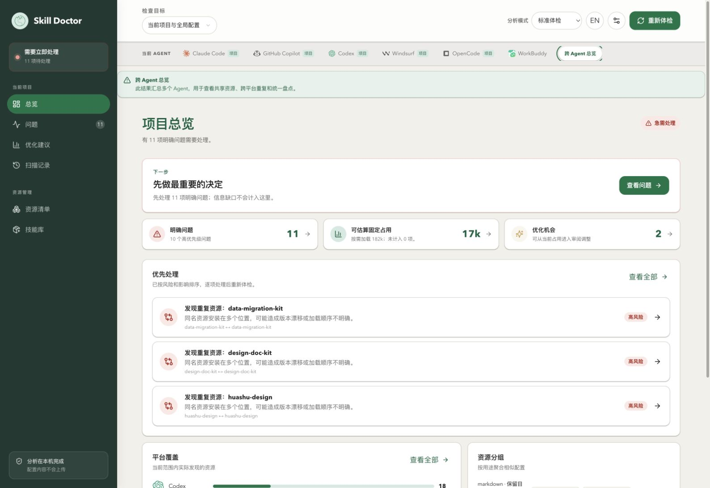

**本例看到什么：** 总览显示 **11 项明确问题**，其中有 `data-migration-kit` 等重复提示。

**有什么帮助：** 这一步建立本次检查边界。后面减少清单中的显示数量，或切换到单一 Agent，都不代表这些重复关系已经被处理。标准体检使用本地关键词规则；本次没有开启 MCP 工具发现和 AI 审计／冲突边界分析。

若本机已有 analysis 服务配置，打开 Skill 详情时仍可能使用它补充解释；这是扫描阶段 AI 审计以外的入口，无需为本篇新增模型配置。

## 3. 进入问题列表，先看类型而非只看总数

**操作：** 点击左侧「问题」。保留「全部类型」和「需处理」，搜索框留空。

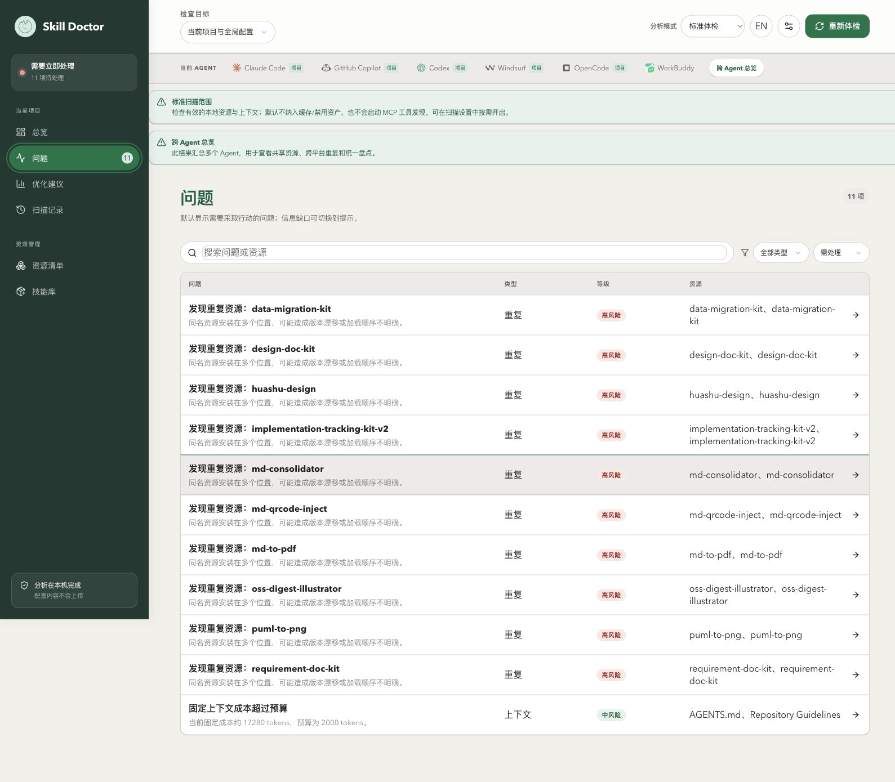

**本例看到什么：** 列表包含多组「重复 · 高风险」，同时还有一条「上下文 · 中风险」预算问题。

**如何使用这个结果：** 11 是当前范围内的待处理问题总数，不能解释为 11 条冲突或 11 份应删除的文件。先按类型分开核对，避免为了处理重复而误把预算问题也当成重复文件。

## 4. 筛出重复问题，再定位一组对象

### 4.1 按类型缩小范围

将「类型」改为 **重复**，等级保留「需处理」。

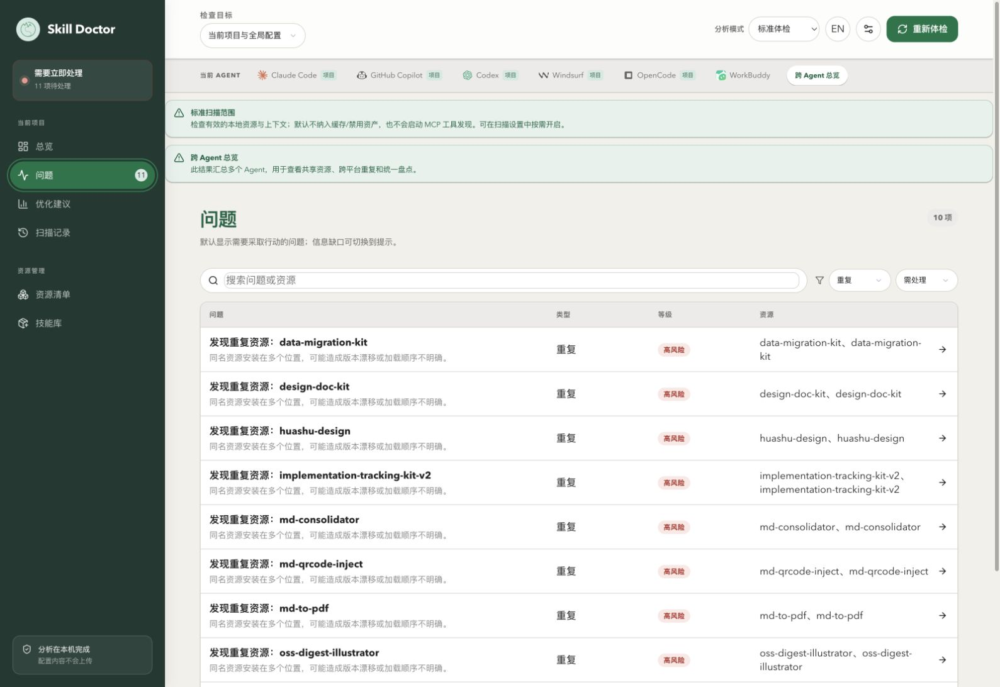

**本例看到什么：** 从 11 项缩小到 **10 项**，上下文预算问题被排除。

**这一步的价值：** 现在处理的是重复关系。10 条关系不等于可以自动删除 10 个目录，也不能据此计算实际重复文件总数；共享资源、多个入口和多方重复关系仍需逐组核对。

### 4.2 按资源名定位

在搜索框输入 **data-migration-kit**。

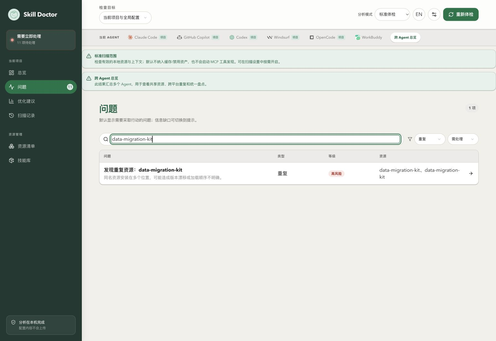

**本例看到什么：** 只剩 **1 项**问题，涉及两个同名资源。

**对你有什么帮助：** 接下来可以针对这一组建立证据，避免在多个相似名称之间来回切换、误选另一组。这里的 1 是问题数量，不是资源只有一份。

## 5. 打开问题，记录两条完整来源

**操作：** 点击「发现重复资源：data-migration-kit」，查看右侧「证据」中的副本 A、B。

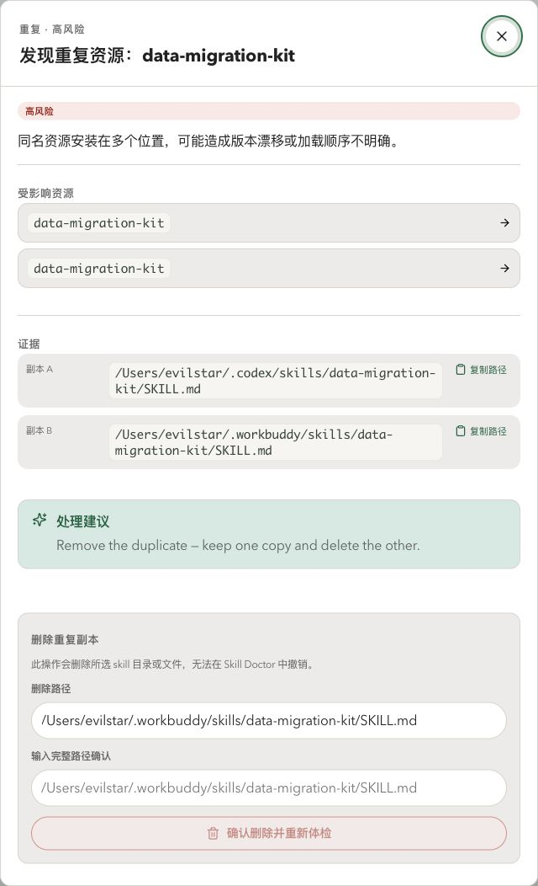

本例证据为：

```text
副本 A：/Users/evilstar/.codex/skills/data-migration-kit/SKILL.md
副本 B：/Users/evilstar/.workbuddy/skills/data-migration-kit/SKILL.md
```

**可以确认什么：** 两条扫描入口分别位于 Codex 和 WorkBuddy 的用户级 Skill 目录。

**还需要核对什么：** 入口背后是否是链接、是否指向其他仓库、正文是否相同，以及各 Agent 是否需要独立版本。告警里的“保留一份”建议和删除下拉框的默认选项，都不能替代这些判断。

本次不填写删除确认值，按钮保持不可执行。真实清理会删除资源且不能在 Skill Doctor 中撤销，应在确认维护来源、引用和恢复方式后，由用户明确选择目标并确认。本篇继续核对来源与内容。

## 6. 分别查看两份资源的用途和安装来源

### 6.1 核对 Codex 入口

点击「受影响资源」中的一个 `data-migration-kit`，先读详情副标题。两个按钮同名，**以详情实际显示的平台和路径识别对象，不凭按钮顺序判断**。

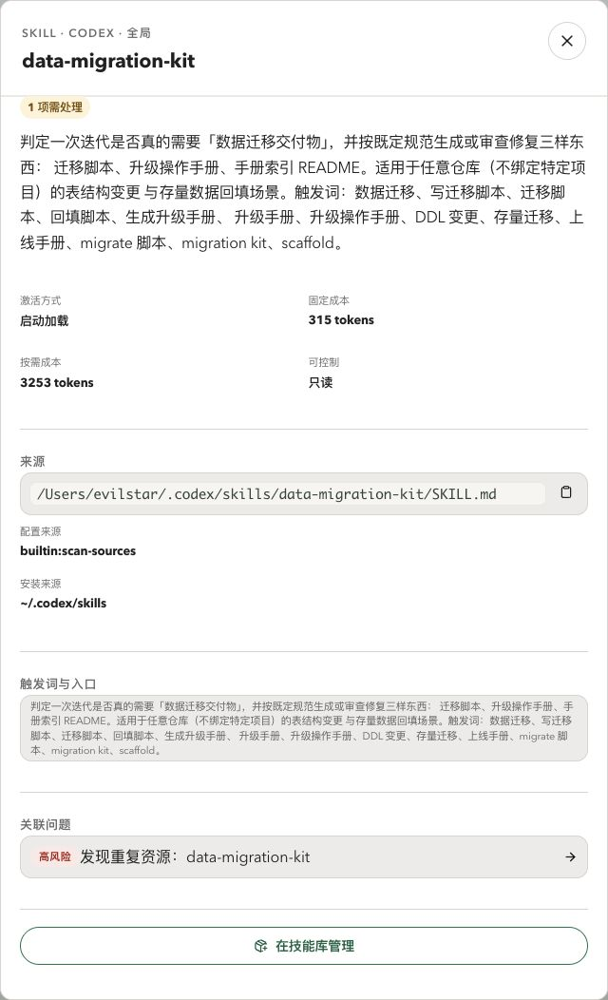

本例这份详情显示：

- 平台／范围：**Codex · 全局**。
- 来源：`.codex/skills/data-migration-kit/SKILL.md`。
- 用途描述：围绕数据迁移脚本、升级操作手册和索引等交付物。
- 关联问题：当前这条重复问题。

**有什么帮助：** 先确认自己看的是哪份文件、它用于什么，再判断是否适合当前任务。「1 项需处理」是关联到同一问题，不是又发现一条独立缺陷。

### 6.2 核对另一份入口

关闭详情，重新打开同一条重复问题，查看另一个同名资源；确认副标题为 **WorkBuddy · 全局**。

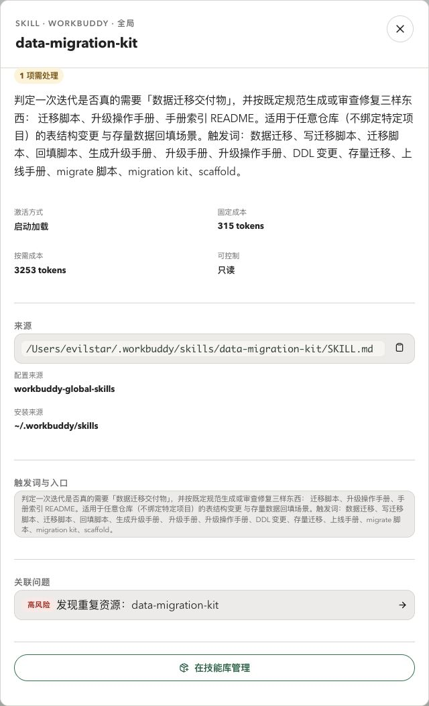

**本例看到什么：** 两边用途描述一致，但安装入口不同。Codex 的配置来源显示 `builtin:scan-sources`，WorkBuddy 显示 `workbuddy-global-skills`。

**如何解读：** 配置来源说明扫描规则从哪里发现入口，不是作者或安全认证。摘要一致也不足以证明完整正文、附带脚本和资源目录都相同，所以下一步继续核对实际文件。

## 7. 用真实路径核对正文与链接目标

**适用场景：** 想判断是否已经发生版本漂移，或担心看似独立的入口其实指向另一个仓库。

从图 5 或资源详情复制两条完整路径，在本机编辑器中按路径打开并比较。macOS 用户也可使用以下只读命令；将路径替换为自己实际看到的对象：

```bash
realpath "$HOME/.codex/skills/data-migration-kit/SKILL.md" "$HOME/.workbuddy/skills/data-migration-kit/SKILL.md"
shasum -a 256 "$HOME/.codex/skills/data-migration-kit/SKILL.md" "$HOME/.workbuddy/skills/data-migration-kit/SKILL.md"
cmp -s "$HOME/.codex/skills/data-migration-kit/SKILL.md" "$HOME/.workbuddy/skills/data-migration-kit/SKILL.md"
echo $?
```

`echo $?` 要紧接在 `cmp` 后执行：`0` 表示已读取的两份文件字节一致，`1` 表示不同，其他值需要先排查读取或执行错误。若内容不同，再用编辑器逐行比较，或使用 `diff -u` 检查具体变更。

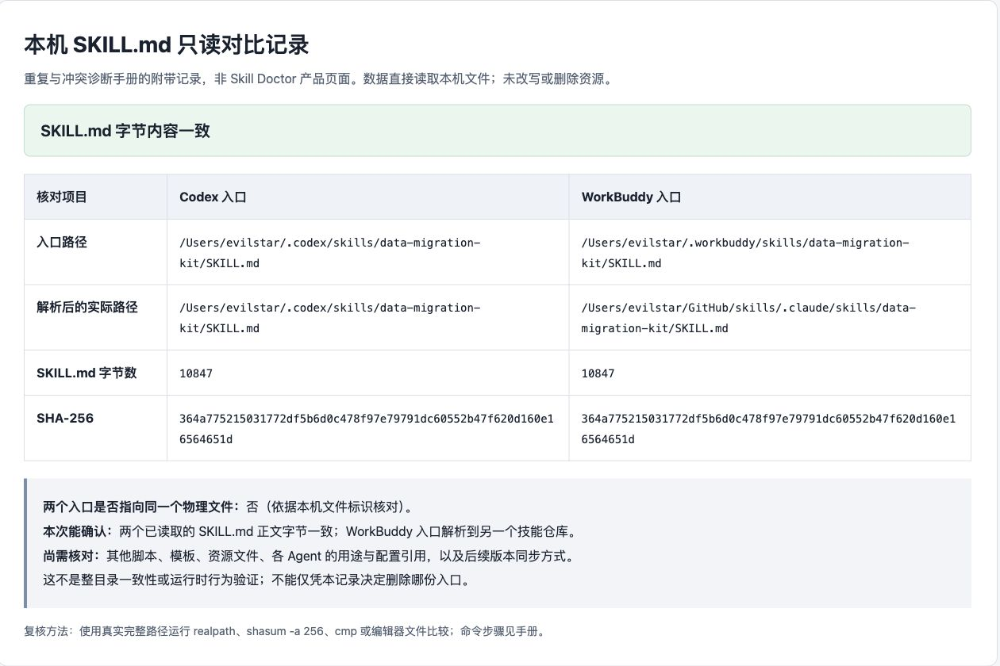

图 8 来自本篇附带的[本次文件核对记录（HTML，下载后可本地打开）](../../assets/manual/conflicts/local-file-comparison.html)，不是 Skill Doctor 新增功能界面。记录直接读取本机文件，结果与实际执行的 `realpath`、`shasum`、`cmp` 核对一致。

**本例结论：**

- 两份 `SKILL.md` 都是 **10,847 字节**，SHA-256 相同，`cmp` 返回 **0**，当前正文字节一致。
- 两个入口指向不同的物理文件。
- WorkBuddy 入口实际解析到 `/Users/evilstar/GitHub/skills/.claude/skills/data-migration-kit/SKILL.md`，涉及另一个技能仓库。

**这些证据如何帮助处理：** 当前不能以“这两份正文已经分叉”为理由直接删除。但它们的更新来源不同，后续仍可能产生版本漂移；处理前应确认维护哪一份、如何同步，以及是否需要保留两个 Agent 的部署入口。

这次只比较了 `SKILL.md`。它不证明整个目录、脚本、模板、权限和实际运行行为一致；正文相同也不要求两份资源必须合并。不要只凭相同摘要、文件大小或告警中的相似度就得出全文一致的结论。

同名副本应按**完整路径**比较。当前 `skill-doctor diff` 用两个不同 Skill 名称解析对象，不适合用 `diff data-migration-kit data-migration-kit` 来指定这两份同名文件。

## 8. 根据证据选择处理思路

本例完成到诊断与来源核对，没有选择删除对象。可按实际情况判断：

| 核对结果 | 处理思路 | 验证重点 |
| --- | --- | --- |
| 正文一致，各 Agent 需要分别部署 | 明确共同维护来源与同步方式，评估统一管理 | 两个 Agent 仍能发现所需入口，后续更新能同步 |
| 正文不同，但有必要的平台定制 | 保留必要差异，写清适用平台与用途 | 差异确实服务于不同需求，而非无意漂移 |
| 一份是已弃用副本 | 先确认来源、链接目标和引用，再由用户确认清理 | 删除的是目标副本，保留版本与依赖仍可用 |
| 入口解析到共享仓库 | 先检查共享来源和其他使用者，再安排变更 | 不误删仍被其他 Agent 使用的维护源 |
| 只是描述与触发范围相近 | 先收窄任务边界、触发条件和使用说明 | 静态告警变化与实际选用行为都符合预期 |

需要集中纳管或同步时，可先阅读[技能库管理说明](skill-library.zh-CN.md)。不必为了让数字变小，就立刻执行删除或重命名；重命名也不会自动解决正文中相互覆盖的任务职责。

## 9. 检查触发冲突，先排除筛选造成的空结果

**适用场景：** 怀疑几个 Skill 会同时覆盖同一类任务，需要区分“规则没检出”与“被搜索或等级条件隐藏”。

关闭详情，回到「问题」：

1. 清空 `data-migration-kit` 搜索词。
2. 将「类型」改为 **冲突**。
3. 将「等级」改为 **全部等级**。

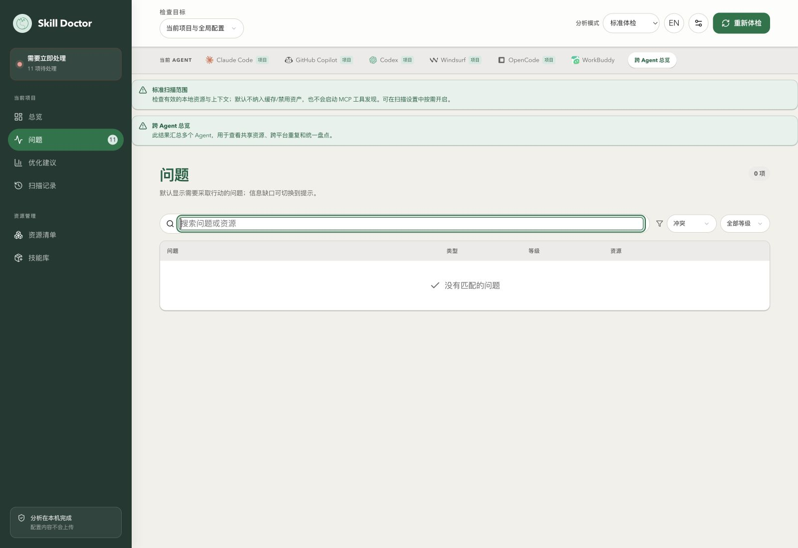

**本例看到什么：** 结果是 **0 项，没有匹配的问题**。本组图片保留这个真实空结果；不能把前面的 10 条重复关系改称为 10 条触发冲突。

**能得出什么结论：** 在本次扫描范围和标准关键词规则下，没有检出触发范围重叠。

**尚不能排除什么：** 标准规则主要分析描述和触发信息，不能证明完整正文逐句无矛盾，也不能保证实际任务中不会选错 Skill。若你观察到问题，仍应按实际任务、描述、原文要求和宿主选用记录继续核对。

### 你的环境有冲突行时，怎样继续？

这次没有非空冲突行；下面说明有结果时的判断路径，图 9 对应本机实际状态：

1. 点击冲突项，记录涉及的两份资源、检测方法、相似度或共享触发信息。
2. 将重叠关键词放回实际场景中判断：是合理的共同领域，还是两个 Skill 都声明接管同一个入口？相似度不是“必然冲突的概率”。
3. 若详情提供「并排对比两个资源」，可查看双方描述、适用场景、触发词和提取到的流程项。它是结构化说明对比，完整文件的逐行差异仍应在编辑器中核对。
4. 根据职责调整描述和触发条件，例如分别约定“只负责迁移脚本审查”和“只负责升级手册整理”，再按相同范围复查，并用实际任务验证选用行为。

若需要语义分析，先核对已配置的 embedding／analysis 服务及其数据发送范围。语义结果同样需要场景复核；本例没有为了得到非空结果而更改模型、阈值或资源内容。

## 10. 恢复默认筛选，确认问题没有被隐藏

**操作：** 搜索框保持为空，「类型」恢复 **全部类型**，「等级」恢复 **需处理**。

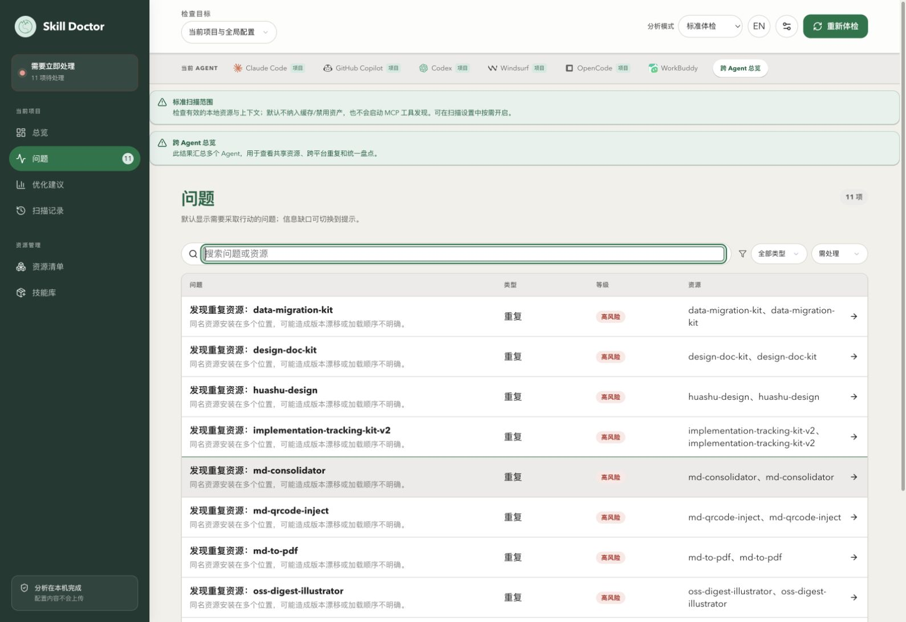

**本例看到什么：** 又显示 **11 项**，重复问题仍在。这与刚才冲突分类的 0 项并不矛盾，它们使用了不同的显示条件。

**对你有什么帮助：** 可以区分“问题被筛掉”与“问题在重新扫描后消失”。调整筛选条件只是阅读方式，不会修改底层配置，也不应被记录为修复收益。

## 11. 重新体检，用同一口径验证处理结果

### 11.1 在同一范围下重新扫描

保持当前项目、跨 Agent 总览、当前项目与全局配置、标准体检及原有预算，点击「重新体检」，等按钮恢复。

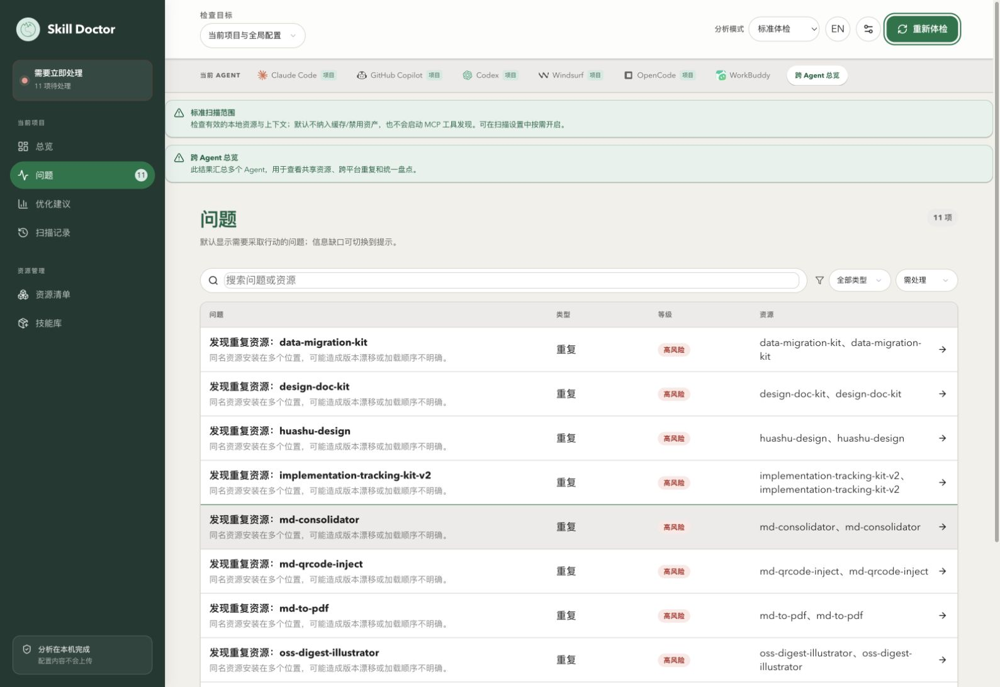

**本例为什么没有减少：** 本次只读取了资源、核对了文件，没有修改或删除入口；确认正文一致并不会自动消除按同名多位置产生的告警。

当你实际完成配置调整后，还应核对原来那组问题是否消失、目标资源和共享入口是否仍符合预期；不要只看总数，因为其他问题可能同时新增或变化。

### 11.2 对照兼容的历史基线

点击「扫描记录」，选同项目、同 Agent、同范围且估算口径兼容的基线，再点击「比较差异」。

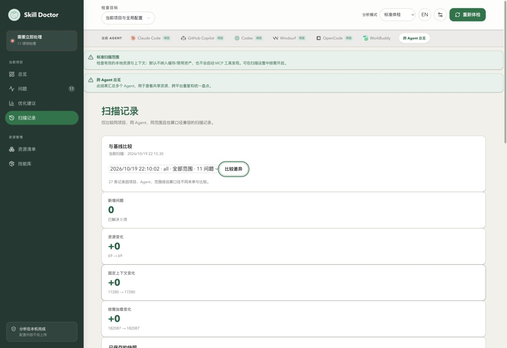

**本例结果：** `22:10:02` 与 `22:15:30` 的两次跨 Agent 全部范围扫描比较，新增问题 **0**、已解决 **0**、资源 **69 → 69**，固定和按需上下文估算也未变化，符合本次只读操作的实际情况。

不能用历史中的“仅 Codex · 1 问题”替代这里的跨 Agent 基线，宣称解决了 10 条问题。真正处理后的验证应结合：相同口径下对应告警的变化、保留资源的来源与内容，以及受影响 Agent 的实际可用性。

## 12. 这次诊断得到的可行动结论

| 需要回答的问题 | 本机实际结论 | 后续用途 |
| --- | --- | --- |
| 重复和冲突分别多少 | 10 条重复、0 条触发冲突，另有 1 条预算问题 | 按类型安排处理，不混淆总数 |
| 选中的两份正文是否不同 | 两份 `SKILL.md` 字节一致 | 不把当前告警误判为已发生正文漂移 |
| 是否只是一个物理文件的两个名字 | 本例不是；WorkBuddy 入口解析到另一技能仓库 | 先确认维护源与链接影响，再决策 |
| 是否已经完成修复 | 没有，复查仍为 11 项，历史差异为 0 | 如实记录诊断进度，不将筛选或核对当成修复 |
| 下一步是什么 | 核对附带文件、平台需求与同步方式 | 由维护者决定保留、统一管理或确认清理 |

## 13. 本组图片中可能需要复核的信息

使用本机真实环境，未额外打码。以下位置可能涉及内部配置和工作流信息：

| 图片或记录 | 具体位置与内容 |
| --- | --- |
| 图 1–4、10、11 | 总览卡片、问题标题与资源列，包含本机 Skill 名称及告警分布 |
| 图 5 | 副本 A、B 和删除面板中的完整用户目录路径；确认框显示的是占位提示，未输入确认值 |
| 图 6、7 | Skill 的中文用途描述、触发说明、安装来源与完整用户目录路径 |
| 图 8、附带 HTML | 用户名、两个安装入口、WorkBuddy 实际链接到的另一仓库路径、文件字节数与 SHA-256 |
| 图 9 | 当前已检测 Agent 和本次问题数量；图中的空结果只针对冲突筛选 |
| 图 12 | 当前扫描与基线的实际操作时间、Agent、范围、问题数及资源／上下文估算 |

本组图片与附带记录未展示 API Key、本地服务会话访问凭据或完整 Skill 正文。

下一篇：[上下文成本与预算](context-budget.zh-CN.md)。

继续了解：[资源清单与来源追溯](resources.zh-CN.md) · [项目体检](health-check.zh-CN.md) · [命令参考](../README.zh-CN.md)。
