# Context Cost and Budget Manual

[Manual index](README.md) · [English project README](../../README.md#documentation) · [中文](context-budget.zh-CN.md) · [Previous: Duplicate and conflict diagnosis](conflicts.md) · [CLI reference](../README.md)

Use this manual when an agent loads more and more instructions at startup, when you want to know which rules or Skills to inspect first, when you see a “Fixed context cost exceeds budget” warning, or when you need a reviewable cost threshold for a project.

The workflow is: set the scan scope → understand the estimates → find high-cost resources → check one agent → inspect over-budget evidence → change the budget and rescan → restore the original value. By the end, you should be able to distinguish lower resource cost from a changed alert threshold.

## 1. Actual environment used in this walkthrough

- Date: **2026-10-19**; macOS; Skill Doctor repository version **0.7.1**.
- Project: <code>/Users/evilstar/GitHub/skill-doctor</code>.
- Scope: **Current project and global configuration**. The main flow uses **Cross-agent overview** and switches to **WorkBuddy** to check one agent.
- Mode: **Standard check**, with context cost enabled. Disabled resources and plugin cache are excluded; MCP tool discovery and AI audit/conflict analysis are off.
- Tokenizer: **OpenAI tokenizer**, identified as **gpt-4o** in the details; original budget was **2,000 tokens**.

This walkthrough only scans, views sources, and changes the budget. It does not edit Skill contents, disable resources, or delete files. The budget was temporarily changed to **20,000**, then restored to **2,000** and rescanned. All images are screenshots of the actual local UI; detail views use original crops so the values are readable.

## 2. Set the scope and open current usage

Start the local UI:

```bash
npx @evilstar2025/skill-doctor ui /path/to/your-project
```

Replace the path with your actual project directory. For source setup, see [Starting the local UI](health-check.md#2-start-the-local-ui). This walkthrough ran <code>npm run dev -- ui . --port 4173 --no-open</code> and opened the full local URL printed by the terminal.

1. Set the top-level “Inspection scope” (检查范围) to **Current project and global configuration** (当前项目与全局配置), and the analysis mode to **Standard check** (标准体检).
2. Click **Cross-agent overview** (跨 Agent 总览) and wait for the scan to finish. If you only change the scope, click “Rescan” (重新体检).
3. In the overview, click the **Estimated fixed usage** (可估算固定占用) card.

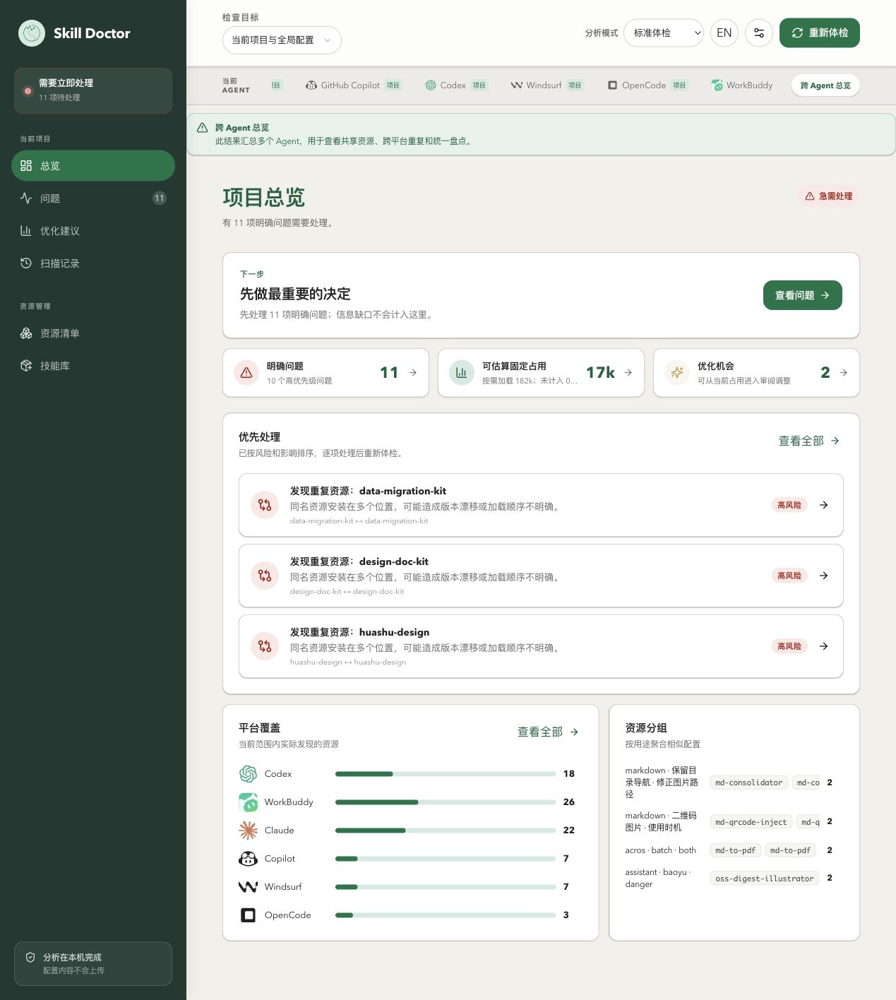

**What this example shows:** The overview has **11 issues to review**, about **17k** fixed usage, and about **182k** on-demand loading. The card uses abbreviated values; open the details to read the full numbers.

**Why set the scope first:** Cross-agent overview is useful for inventorying the machine and finding shared sources. It aggregates estimates across platforms; it does not mean that all this content was included in one agent’s request. Before setting a daily budget for one platform, switch to that agent and check its own estimate.

## 3. Understand the four metrics before deciding whether to optimize

The page opens to **Current usage** (当前占用) under “Optimization suggestions” (优化建议). It shows the current scan snapshot; you do not need to change configuration first.

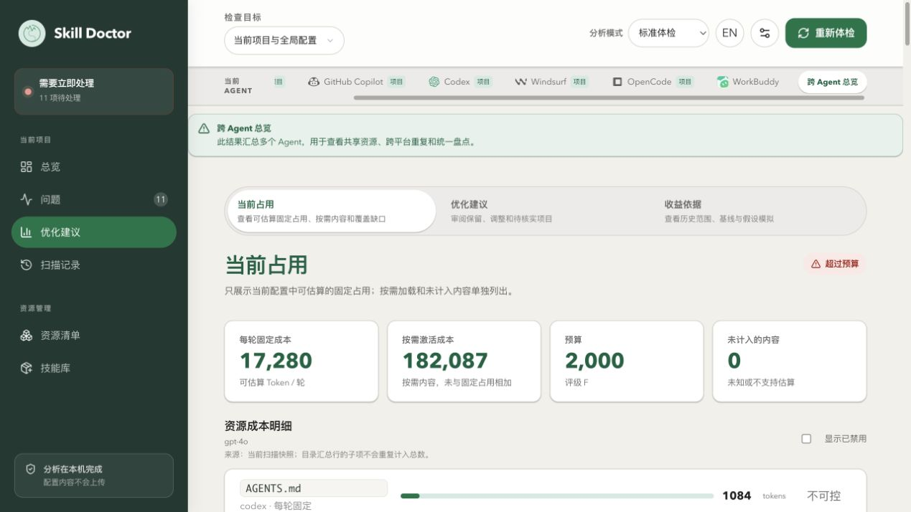

| Metric | Local reading | Meaning and use |
| --- | --- | --- |
| Fixed cost per turn | **17,280 tokens** | Estimated always-on instructions, startup directory, descriptions, and similar items under the current platform loading rules. Compare this with the budget and look first for content loaded every turn. |
| On-demand activation cost | **182,087 tokens** | Combined estimate for activation text from cost entries, often including full Skill contents. It helps identify resources that may be large when loaded; it does not mean they were invoked in this turn. |
| Budget | **2,000 tokens, grade F** | The threshold used by this scan to flag fixed cost above expectations. It is not the model context window and does not limit what an agent actually receives. |
| Uncounted content | **0 items** | Number of current cost entries marked unknown or unsupported. It is not a token count for omitted content and does not prove that all runtime content is covered. |

**Do not add fixed and on-demand estimates directly.** Activation estimates may also include fixed files or directory entries; they are not a pure increment on top of fixed usage. So do not treat <code>17,280 + 182,087</code> as the input, per-turn usage, or bill for one request.

**Limits of “0 uncounted”:** This scan did not connect to MCP to retrieve a real tool list, so MCP estimates may come only from static configuration descriptions. Hidden agent instructions, conversation history, this turn’s user input, tool results, and later file reads are also not covered by that zero. If an item says “— / uncounted,” collect more evidence first; do not treat it as zero cost.

**How to interpret the tokenizer:** This estimate counts text with a local OpenAI tokenizer and does not call a model service. It is not a measurement from a real model request. Current static estimates also normalize whitespace and select metadata, body text, or a portion depending on resource type. “Approximate estimate” uses character-based estimation instead. If you change the tokenizer or estimation scope, establish a new comparison baseline.

The grade describes only the ratio of fixed estimate to budget:

| Grade | Fixed estimate ÷ budget |
| --- | --- |
| A | ≤ 25% |
| B | > 25%, ≤ 50% |
| C | > 50%, ≤ 100% |
| D | > 100%, ≤ 150% |
| F | > 150% |

Here <code>17,280 / 2,000 = 864%</code>, so the grade is F. This is not a security score and does not mean a task will fail.

## 4. Find resources to inspect in the cost details

### 4.1 Start with entries that have high fixed costs

**Action:** Scroll down to “Resource cost details” (资源成本明细). Read the platform, loading method, and value on the right, and start with entries related to the platform you actually use.

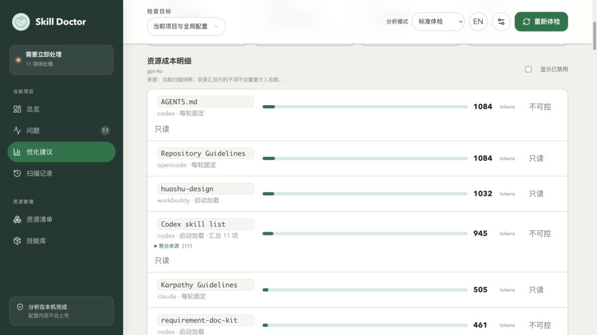

**Entries to check first in this example:**

- <code>AGENTS.md</code>: Codex, fixed each turn, **1,084 tokens**.
- <code>Repository Guidelines</code>: OpenCode, fixed each turn, **1,084 tokens**.
- <code>huashu-design</code>: WorkBuddy, loaded at startup, **1,032 tokens**.
- <code>Codex skill list</code>: Codex, an aggregate of **11** startup-loaded entries, **945 tokens**.

**How this helps:** Reviewing always-on instructions that are long or only loosely related to the current task can be more useful than looking at file size alone. If same-name content appears on different platforms, check its users and sources; do not assume all those costs appear in the same request.

The details are not a ranking of complete file sizes. Startup-loaded Skill rows generally estimate the descriptions used to select a Skill; an on-demand row may estimate activation cost. Bars are relative visual indicators, not a percentage of the budget. Use the fixed total and budget at the top to judge an over-budget result.

### 4.2 Open a high-cost Skill and distinguish its description from its body

**Action:** Click <code>huashu-design</code> in the **WorkBuddy** row. Confirm the platform and scope in the details, then scroll to “Fixed cost” (固定成本), “On-demand cost” (按需成本), and “Source” (来源).

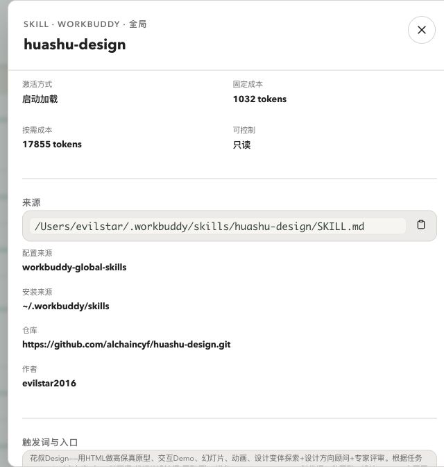

**What this example shows:** Fixed cost is **1,032 tokens** and on-demand cost is **17,855 tokens**. The installation entry point is <code>/Users/evilstar/.workbuddy/skills/huashu-design/SKILL.md</code>, and it is marked read-only.

**How to choose what to inspect:** If you are concerned about startup load, review whether the description and trigger scope are too long or broad. If you are concerned about a large amount of context after invocation, check whether the body loads many scenarios, examples, and procedures at once. You might shorten the selection description or have the body refer to task-specific material, while preserving necessary constraints and verifying the result with real tasks.

The values 1,032 and 17,855 are not two independent amounts already spent in this turn. A large body alone also does not prove the Skill is unnecessary. Decide whether to change it based on usage frequency, task value, and correctness requirements. This walkthrough only inspected the resource; it did not rewrite it.

### 4.3 Expand aggregate rows to avoid double-counting

**Action:** Close the details and click **Aggregated sources (11)** (聚合来源（11）) under <code>Codex skill list</code>. Scroll within the source area to view paths.

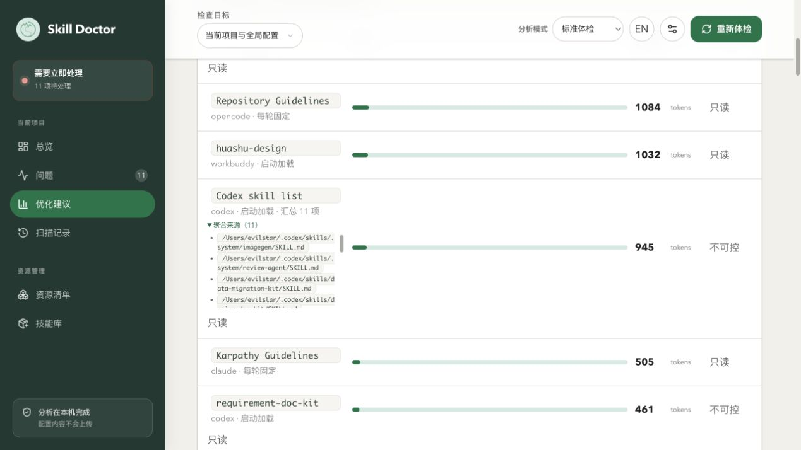

**What this example shows:** The aggregate contains several local Codex <code>SKILL.md</code> entry points, from both user-level directories and the current project. Expanding the row only displays its members; it does not load additional content.

**How to interpret it:** The aggregate is calculated using the current estimator’s directory rules, and the members still appear in their own detail entries. The fixed total does not count the same Codex metadata members again individually. Do not add 945 to every member value, and do not treat it as an exact count of a directory block in a live session.

“Current usage” for Codex alone also provides local evidence of content injected into historical sessions. That view is scoped to a selected session and serves a different purpose from the static configuration estimate here. See the [Codex context optimization manual](codex-optimization.md) for its evidence limits; do not add it to the cross-agent values in this manual.

## 5. Switch to the agent you actually use to set a meaningful budget

**Action:** Click **WorkBuddy** in the top agent bar and wait for its automatic check to finish. Keep “Current project and global configuration” selected and return to the top of Current usage.

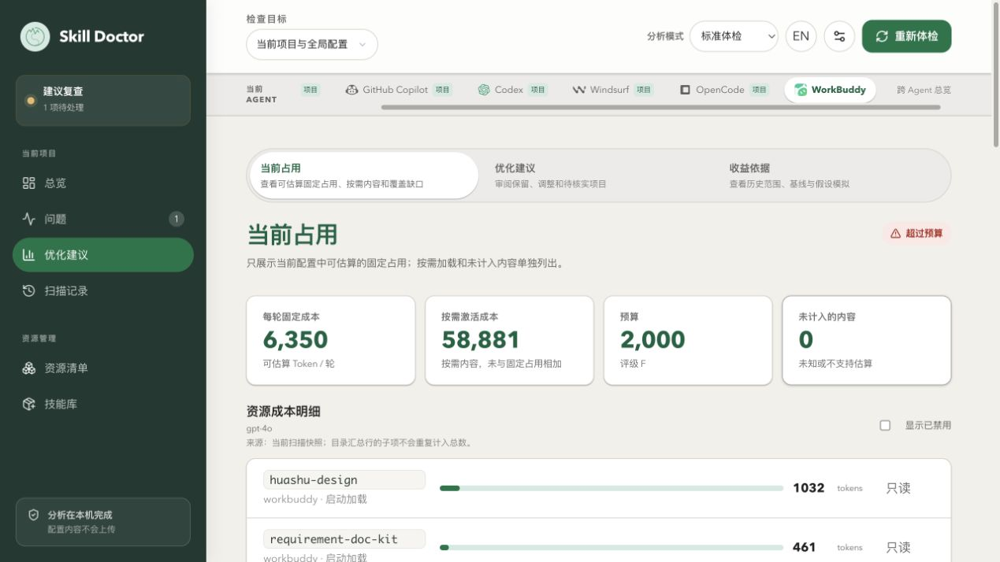

**What this example shows:** Fixed usage becomes **6,350 tokens**, on-demand usage is **58,881 tokens**, and the budget remains **2,000**.

**Why it helps:** You can now plan reviews and budgets around the platform you actually use. The change from 17,280 to 6,350 means the scan target changed; it does not mean that 10,930 tokens were saved. Do not use these two scopes as an optimization before-and-after comparison.

Set a budget based on the agent’s tasks, accepted always-on instructions, and the context space you want to leave for conversation and tool results, then review it against actual tasks. This manual now returns to **Cross-agent overview** to demonstrate how changing the budget threshold affects the aggregate result. **20,000 is only a value used in this walkthrough, not a recommended default for every project.**

## 6. Find the over-budget warning and inspect its evidence

**Action:** Click “Cross-agent overview” at the top and wait for the check to finish. Open “Issues” (问题) in the left navigation. Clear the search, set “Type” to **Context** (上下文), and leave “Severity” at **Needs attention** (需处理).

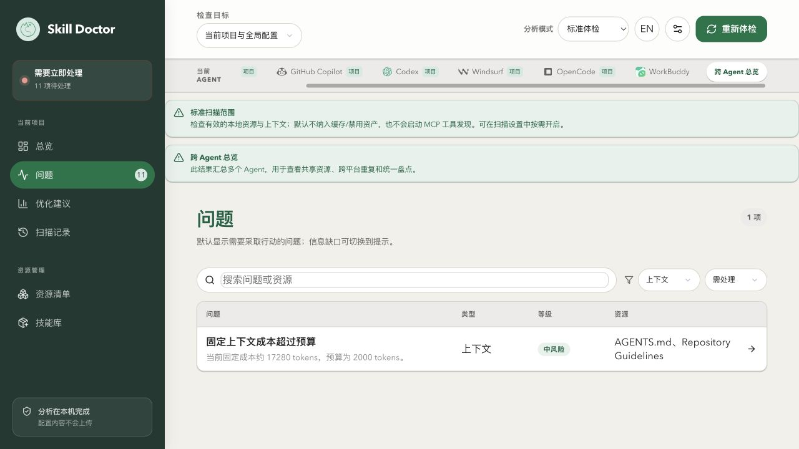

**What this example shows:** The filter returns **1 issue**: “Fixed context cost exceeds budget,” with a summary of **17,280 / 2,000 tokens**. The 11 in the sidebar is the overall issue count, not 11 budget warnings.

Click the issue to inspect its details:

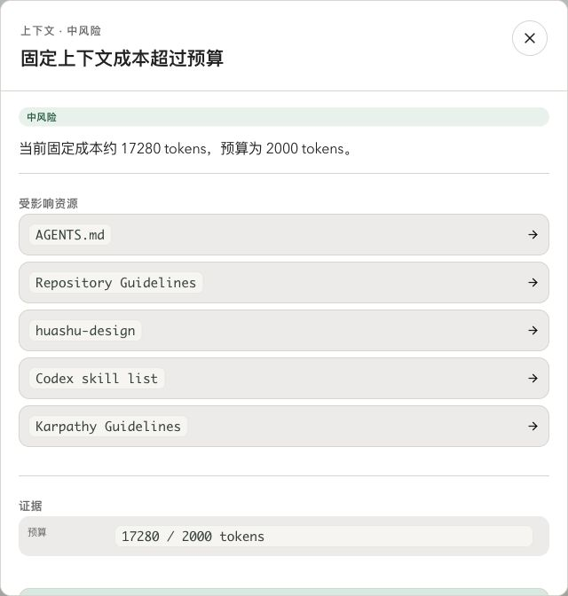

**How to use the evidence:** The values match Figure 2. Start by tracing the listed high-cost resources to their sources. Affected resources are leads for review; deleting one of them does not necessarily bring usage under budget, and resources not listed may still have costs.

## 7. Change the budget and confirm that only the threshold changed

### 7.1 Record the original value and tokenizer

**Action:** Close the issue details, click **Scan settings** (扫描设置), and scroll down to “Cost budget” (成本预算).


**Original values in this example:** The per-turn budget is **2,000**, and the tokenizer is **OpenAI tokenizer**. Record them so you can reproduce and restore the settings. Keep context cost on and leave the other analysis features, platform, and scope unchanged.

**When to change the budget:** If you have reviewed the always-on content and accept its value, you can adjust a threshold that no longer fits the scan scope. If your goal is to reduce actual input, change the content or loading method and rescan with the same budget.

### 7.2 Save the new threshold and rescan

Change “Per-turn budget (tokens)” (每轮预算（tokens）) to **20000**. Keep the tokenizer unchanged and click **Save and rescan** (保存并重新体检).

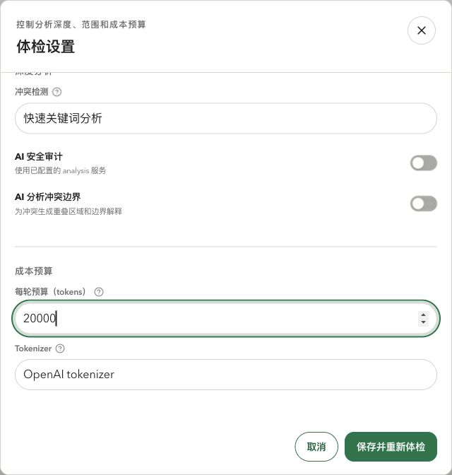

Wait until the top button returns to “Rescan” (重新体检). The new budget is applied to the next scan result; changing the input field alone does not show that the result has updated. This changes Skill Doctor’s scan preference, not the agent’s model context window or actual token limit.

### 7.3 Check both the alert and the cost

Keep the same search, type, and severity filters on the issue page and check whether the budget warning changed:

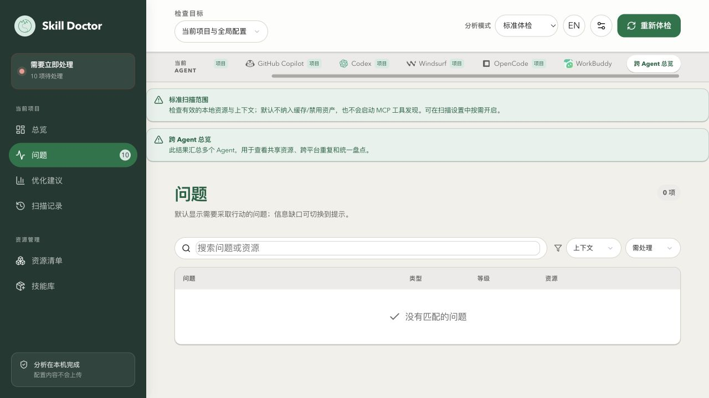

Then click “Optimization suggestions” (优化建议) in the left navigation, switch to **Current usage**, and read the cost under the same scope:

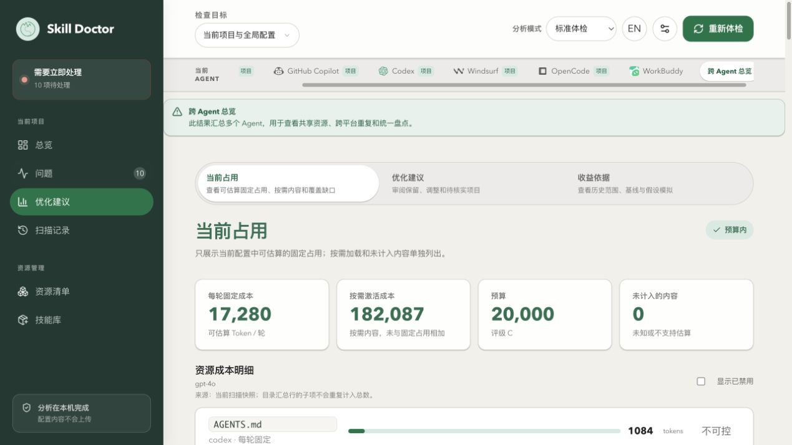

| Observation | Before | After |
| --- | --- | --- |
| Budget | 2,000 | 20,000 |
| Fixed estimate | 17,280 | 17,280 |
| On-demand activation estimate | 182,087 | 182,087 |
| Status / grade | Over budget / F | Within budget / C |
| Context-budget warning | 1 | 0 |
| Overall issues to review | 11 | 10 |

**What this demonstrates:** The new budget took effect. <code>17,280 / 20,000 = 86.4%</code>, so the grade is C; the budget warning no longer applies, while the 10 duplicate issues remain. Resource costs did not decrease, so do not record token or cost savings, or improved speed.

## 8. Restore the original budget and leave a reviewable result

This is a manual walkthrough, so restore the recorded original value: reopen “Scan settings,” set the per-turn budget back to **2000**, and click **Save and rescan**.

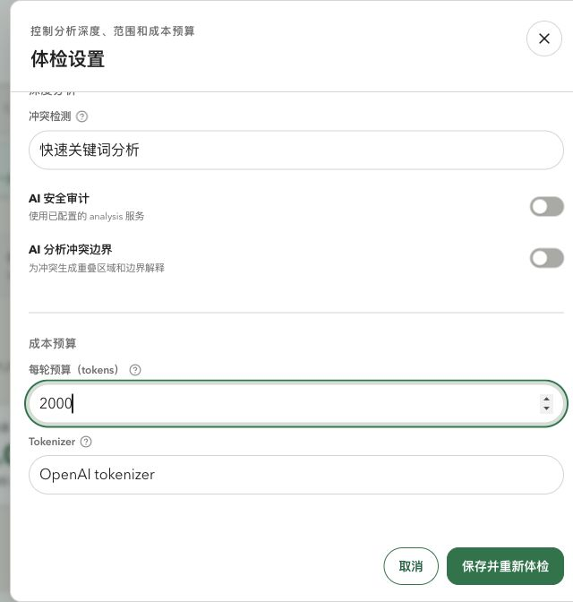

Wait for the scan to finish, then check Current usage:


**Final state in this example:** Fixed usage is **17,280**, on-demand usage is **182,087**, budget is **2,000**, grade is **F**, and there are still **11 issues to review**. Resource contents and enabled state did not change. The restored result matches the one before the walkthrough.

After changing resources in your own environment, keep the project, agent, scope, tokenizer, and budget the same when comparing costs and sources. Scan history provides baselines only for compatible scopes; records with different budgets are not offered as the same baseline. “One fewer warning after changing the budget” is not evidence of resource optimization.

## 9. Choose a next step based on the source of the cost

| Finding | What to try first | How to verify |
| --- | --- | --- |
| Always-on rules are long | Review repeated explanations, outdated constraints, and sections needed by only a few tasks; keep necessary rules | Fixed estimate falls under the same scope, and new tasks still follow the necessary constraints |
| Startup descriptions are long or triggers are broad | Shorten selection instructions and state responsibilities and conditions clearly; move details to material read only when invoked | Startup estimate changes and real tasks still select the right Skill |
| Descriptions are small but activation cost is high | Check whether references can be split by task so unrelated examples are not loaded each time | Actual content read and tool records match expectations; do not compare file size alone |
| MCP tool descriptions may be large | Check whether a real tool list was obtained rather than relying on a static estimate; then review exposed tools | Compare under the same scope after obtaining the list and confirm required tools still work |
| Estimate is unknown or unsupported | Find out what configuration, readability, and detection capabilities are involved; collect evidence first | Explain the unknown state instead of treating “—” as zero |
| The budget is simply too strict | Record why you accept the current content and choose a reasonable threshold for the platform and scope | Confirm the new budget was applied and state whether the actual cost changed |

“Read-only / not controllable” means the current UI cannot directly adjust the entry; it does not mean the file can never be maintained. “Writable configuration; verify in a new task” also does not mean the host has adopted a change. Before disabling or rewriting anything, check shared users, preview the exact change, and verify it in a new task in the actual agent. This walkthrough did not make those changes.

## 10. Information in these screenshots to review before sharing

The screenshots show the actual local environment without additional redaction. These areas may reveal personal paths or workflow details:

| Images | Location and information |
| --- | --- |
| Figures 1–3, 6–8, 11, 12, and 14 | Detected agents, Skill and rule names, issue distribution, platform selection, budget, and context estimates |
| Figure 4 | Full user-directory path, installation source, linked repository address, author, and some purpose or trigger description for a high-cost Skill |
| Figure 5 | Expanded aggregate sources, including the username, Codex user directory, and project Skill paths |
| Figures 9, 10, and 13 | Local budget, tokenizer, and AI-analysis switches; the screenshots focus on the cost-budget area |

These images do not show API keys, local-service session credentials, or complete Skill contents.

Next: [Security audit](security-audit.md).

Further reading: [Resource inventory and source tracing](resources.md) · [Duplicate and conflict diagnosis](conflicts.md) · [Codex context optimization](codex-optimization.md).
