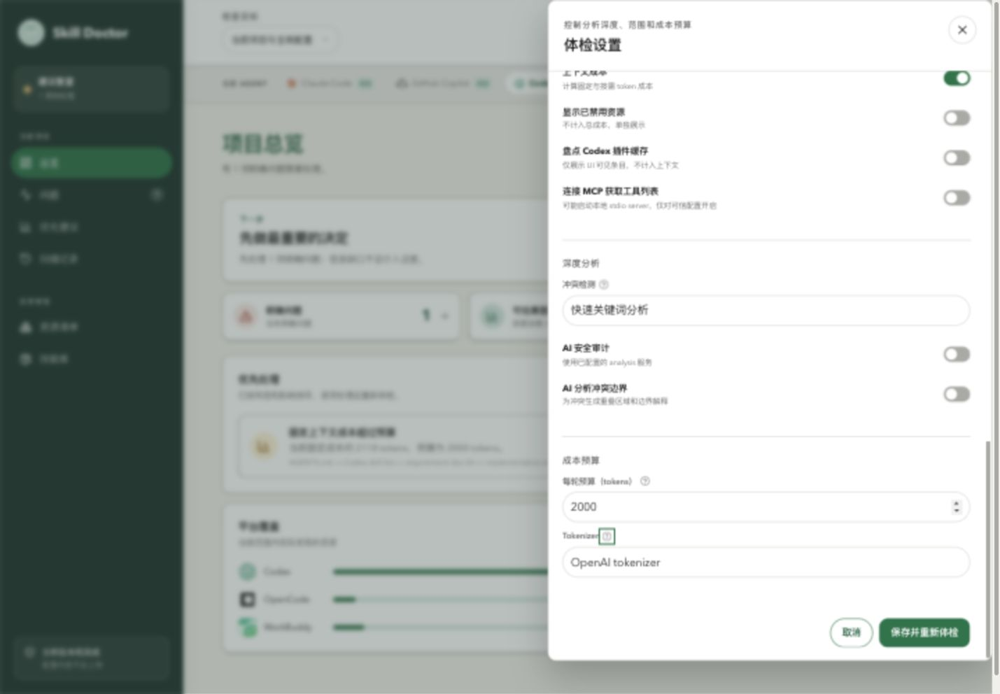
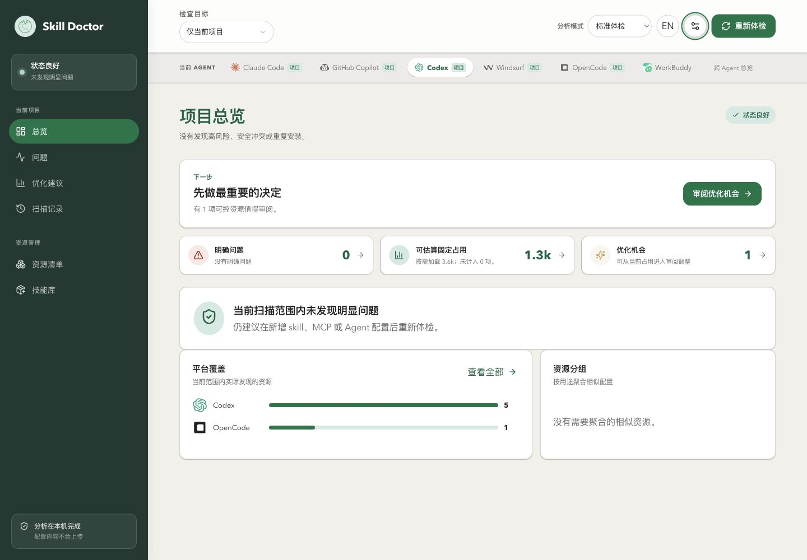
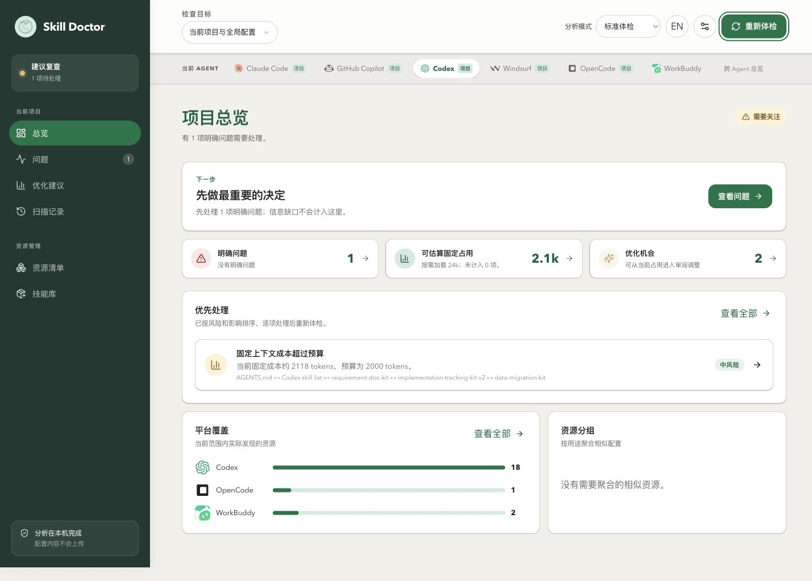
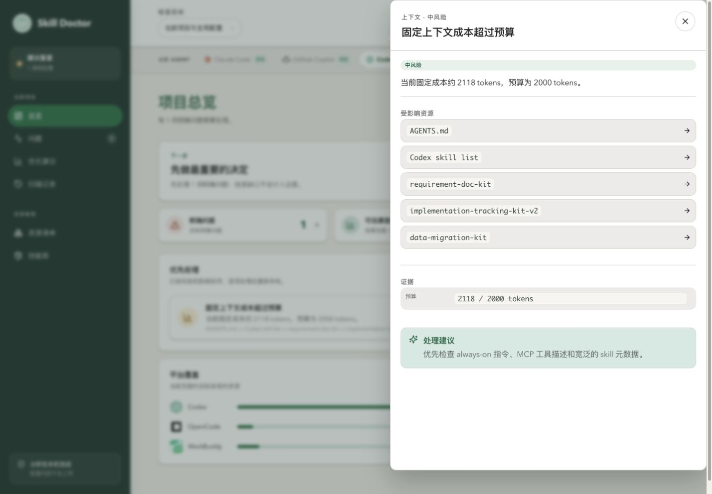
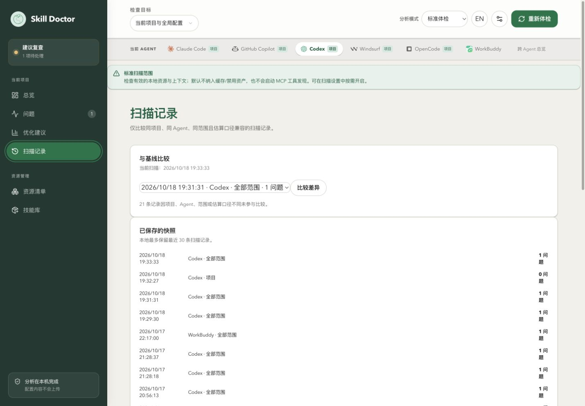

# 项目体检使用手册

[手册目录](README.zh-CN.md) · [English](health-check.md) · [返回 README](../../README.zh-CN.md#文档) · [命令参考](../README.zh-CN.md) · [平台支持范围](../platform-support.zh-CN.md)

本篇带你完成一次项目体检：启动本地界面、确认项目与 Agent、选择扫描范围、读取总览、查看问题证据，再重新体检。适合第一次使用 Skill Doctor，或希望在新增 Skill、Rules、Instructions、MCP 配置后检查项目的用户。

体检会盘点资源，检查重复、触发重叠和静态安全线索，并估算可识别的上下文占用。体检本身不会替你修改或卸载 Agent 资源；完成扫描后会保存本地扫描记录。

## 1. 本篇的实际环境

以下图片来自本机的实际配置与真实扫描，没有使用 demo 项目，也没有为制造问题修改 Skill 或 Agent 配置。

| 项目 | 本次演示使用的值 |
| --- | --- |
| 实操日期 | 2026-10-18（Asia/Shanghai） |
| 系统 | macOS |
| Skill Doctor | 当前仓库版本 0.7.1 |
| Node.js | v25.4.0；运行要求为 Node.js 20 或更高版本 |
| 项目目录 | `/Users/evilstar/GitHub/skill-doctor` |
| 当前 Agent | Codex |
| 分析模式 | 标准体检 |
| 扫描范围 | 先「仅当前项目」，再「当前项目与全局配置」 |
| 每轮预算 | 2,000 tokens |
| Tokenizer | OpenAI tokenizer（`gpt-4o`） |

你的资源数量、风险和 Token 估算会随本机配置变化，不需要与截图相同。对照时先核对项目、Agent、范围和预算。

## 2. 启动本地界面

### 使用已发布的工具

在终端进入你要检查的项目目录，执行：

```bash
npx @evilstar2025/skill-doctor ui
```

也可以直接指定项目，并自行打开浏览器：

```bash
npx @evilstar2025/skill-doctor ui /path/to/your-project --port 4173 --no-open
```

把 `/path/to/your-project` 替换为实际项目目录。端口已占用时，换一个端口或省略 `--port`，由系统分配。

### 从本仓库运行

已经下载源码的用户，在仓库根目录准备依赖并构建：

```bash
npm install
npm run build
```

本次实操使用以下命令启动：

```bash
npm run dev -- ui . --port 4173 --no-open
```

`.` 表示当前仓库。`npm run dev` 启动后端；界面使用刚构建的 `dist/ui/`。只运行 `npm run dev:ui` 不能替代这里的完整本地服务。

终端会打印以 `Skill Doctor UI:` 开头的地址。使用终端实际输出的完整链接打开界面；链接包含当前本地服务的访问凭据，不要把其他人的链接或固定示例地址当作自己的入口。结束使用后，可在启动服务的终端按 `Ctrl+C`。

## 3. 确认项目、Agent 与体检方式

### 首次使用

出现「确认检查目标」窗口时，依次操作：

1. 检查「项目目录」；需要更换时输入路径，或点击「选择目录」。
2. 点击「检测 Agent」，根据该项目实际使用的平台选择 Agent。本篇选择 **Codex**。
3. 选择 **标准体检**，点击「开始体检」。

如果项目存在多个 Agent 配置，需要明确选择一个；希望统一盘点时可以选择「跨 Agent 总览」。Agent 标签表示检测到了对应配置，不代表这些程序正在运行。

### 已有体检记录

本机已有历史记录，实际启动后直接进入总览，没有出现首次引导。遇到这种情况，先确认启动命令指定的项目，再检查顶部 Agent、范围和分析模式，并重新体检；不要直接把启动时显示的旧记录作为本次结果。

### 核对扫描选项

在顶部「分析模式」中选择 **标准体检**。点击旁边的「扫描设置」，本篇使用以下设置；窗口内容较长时向下滚动查看：

| 选项 | 本篇设置 | 用途 |
| --- | --- | --- |
| 上下文成本 | 开启 | 估算固定与按需占用 |
| 显示已禁用资源 | 关闭 | 本次只看有效资源 |
| 盘点 Codex 插件缓存 | 关闭 | 本次不把缓存目录作为额外盘点对象 |
| 连接 MCP 获取工具列表 | 关闭 | 本次不启动 MCP 工具发现 |
| 冲突检测 | 快速关键词分析 | 使用关键词线索检查重叠 |
| AI 安全审计／AI 分析冲突边界 | 关闭 | 本篇不使用模型辅助分析 |
| 每轮预算 | 2000 | 与固定上下文成本比较的预算线 |
| Tokenizer | OpenAI tokenizer | 计算文本 Token 估算 |



**图 1 解读：** 使用快速关键词分析，两项 AI 分析关闭，预算为 2,000。上下文成本与 MCP 等开关位于同一抽屉更上方，按上表核对。模型服务配置不属于完成本篇的必要条件，无需为标准体检填写 API Key。

完成设置后，点击「保存并重新体检」。如果只是核对、没有改动，可关闭设置，再按下一节选择范围。

如果主动开启 MCP 工具发现，可能连接已配置的服务，stdio 配置还可能启动本地命令；深度体检可使用你配置的分析或嵌入服务。这些选项的行为与本篇关闭相关开关时不同。

## 4. 先检查「仅当前项目」

1. 将顶部「检查目标」下的范围切换为 **仅当前项目**。
2. 在 Agent 标签栏选择 **Codex**。切换 Agent 会发起对应体检；切换范围后，点击「重新体检」应用新范围。
3. 扫描过程中按钮会变为「取消」。等待扫描完成、按钮恢复为「重新体检」，再读取结果。
4. 打开左侧「总览」。窄窗口下，导航位于页面底部，Agent 标签栏可以横向滚动。



**图 2 解读：** 这次项目范围体检显示「状态良好」，明确问题为 **0**；可估算固定占用约 **1.3k tokens**，按需加载约 **3.6k**，未计入 **0 项**，优化机会为 **1**。平台覆盖区域列出 Codex **5**、OpenCode **1** 个资源条目。

「没有明确问题」与「仍有优化机会」可以同时成立。前者说明本次范围内未发现需要列为问题的项目，后者表示仍有可审阅的资源或控制能力；不代表必须禁用某项资源。

## 5. 再检查「当前项目与全局配置」

全局配置也可能影响这个项目。保持同一个项目、Codex、标准体检和预算，进行第二次检查：

1. 将范围切换为 **当前项目与全局配置**。
2. 点击右上角「重新体检」。
3. 等待扫描完成，确认总览中的结果已经更新。



**图 3 解读：** 这次结果变为「需要关注」，明确问题为 **1**，固定占用约 **2.1k tokens**，按需加载约 **24k**，优化机会为 **2**。「优先处理」区域给出「固定上下文成本超过预算」提示。

这张真实截图也保留了当前版本的一处文案不一致：「明确问题」卡片主数字是 `1`，副文案仍显示「没有明确问题」。本例应以总览的「有 1 项明确问题需要处理」、卡片主数字和问题详情证据为准。

本次两种范围的对照如下：

| 指标 | 仅当前项目 | 当前项目与全局配置 |
| --- | --- | --- |
| 明确问题 | 0 | 1 |
| 可估算固定占用（页面约数） | 1.3k tokens | 2.1k tokens |
| 按需加载（页面约数） | 3.6k tokens | 24k tokens |
| 未计入 | 0 项 | 0 项 |
| 优化机会 | 1 | 2 |
| 平台覆盖区域的资源条目 | Codex 5、OpenCode 1 | Codex 18、OpenCode 1、WorkBuddy 2 |

这里展示的是**扫描范围差异**，两次之间没有修复或禁用资源，不能把数字变化称为优化收益。平台覆盖统计也不能直接当成 Skill 安装数量；需要确认具体条目时，进入「资源清单」查看类型、来源和范围。

## 6. 查看问题证据与处理建议

在「优先处理」中点击 **固定上下文成本超过预算**，右侧会展开问题详情。也可以点击「查看问题」进入问题列表后查看。



**图 4 解读：** 详情给出精确到本次估算整数的 **2,118 / 2,000 tokens**，即比配置的预算多 **118 tokens**，页面标为「上下文 · 中风险」。这是一个上下文预算问题，不能据此认定资源包含恶意指令。

详情中需要查看的三部分：

- **受影响资源：** 展示可继续查看的资源入口。本例包含 `AGENTS.md`、`Codex skill list` 和若干本机 Skill 名称；列入这里不代表每个资源都有独立缺陷。
- **证据：** 用实际估算值和预算确认触发原因；不要只根据总览四舍五入后的 `2.1k` 判断。
- **处理建议：** 本例建议优先检查常驻指令、MCP 工具描述和宽泛的 Skill 元数据。先核对来源与用途，再决定是否调整。

本篇到完成诊断为止。不要为了消除一条提示而直接卸载资源；具体配置调整和 Codex 优化流程见 [Codex 优化指南](codex-optimization.zh-CN.md)。

### 总览数字应该怎样读

| 页面信息 | 正确理解 |
| --- | --- |
| 明确问题 | 本次扫描归纳出的待处理项目数量；不等同于高危安全问题数量 |
| 可估算固定占用 | 可识别的常驻上下文估算，不代表每次真实请求的全部输入 Token |
| 按需加载 | 资源激活时可能涉及的文本，不应全部加到每轮固定占用上 |
| 未计入 | 当前无法纳入估算的条目提示；0 项也不能证明运行时动态上下文已被全部覆盖 |
| 优化机会 | 可审阅或可控资源的入口，不是已实现的 Token 节省 |
| 平台覆盖 | 本次返回的资源分布；具体是否为 Skill、指令或其他资源，需要查看资源详情 |
| 状态良好 | 在当前扫描范围、规则与证据下未发现明显问题，不是绝对安全或零成本保证 |

## 7. 重新体检，确认同一口径下的变化

当你确实调整了配置，或新增、移除了资源后：

1. 保持同一项目、Agent、扫描范围、预算和分析选项。
2. 点击「重新体检」，等待任务完成。
3. 查看问题是否减少、相关资源是否发生变化；如果只是改变了预算，不能称为减少了实际占用。
4. 打开「扫描记录」，按需要选择兼容的基线，点击「比较差异」。



**图 5 解读：** 本次 **19:32:27** 的项目范围记录为 **0 问题**，**19:33:33** 的全部范围记录为 **1 问题**，与前面的总览一致。比较区域选择的是另一条 Codex 全部范围记录；不同项目、Agent、范围或估算口径的记录会被排除，不能直接把项目范围的 0 与全部范围的 1 当作一次修复的前后结果。

到这里，你应已能确认检查目标、完成扫描、解释主要数字，并定位问题证据。涉及 Codex 配置控制时，重新扫描的静态结果还不能替代新会话运行时验证。

## 8. 常见问题

### 为什么一打开就有结果？

本机已有扫描快照。核对目标与选项后主动重新体检，以新的完成结果为准。

### 为什么与截图的资源数量不同？

项目目录、全局安装、Agent、扫描来源、禁用／缓存选项都会影响数量。先确认范围，再通过「资源清单」查看来源；如需检查自定义来源，进入「扫描设置 → 扫描来源与路径」。

### 为什么没有资源，或没有检测到预期 Agent？

检查启动命令指向的目录、配置是否存在于受支持路径，以及扫描来源是否启用。仅发现全局配置的 Agent 在「仅当前项目」范围可能没有对应资源。平台覆盖差异见 [平台支持说明](../platform-support.zh-CN.md)。

### 显示「扫描结果不完整」怎么办？

先读页面顶部警告，判断是哪一步未完成。本机启动时加载的旧记录曾包含 `serena: fetch failed` 和 `ast: Timed out waiting for initialize` 两条 MCP 工具发现警告。它们表示当时未取得完整工具信息，不能解释为已经查明资源安全或不安全。

如果只想复现本篇，关闭「连接 MCP 获取工具列表」后重新体检；如果需要工具列表，则检查对应服务或命令后再启用。关闭工具发现会减少这一类连接依赖，也意味着没有本次实时工具列表证据。

### 为什么深度体检不能选？

需要先配置对应的分析或嵌入服务。标准体检可独立完成本篇流程，不要求配置模型。

### 页面提示没有权限或无法打开？

确认本地服务仍在运行，并使用本次终端打印的完整地址进入。重启服务后重新获取地址，勿复用旧会话链接。

### 命令行 `scan`、`check` 与 UI 总览的数量能直接比较吗？

`scan` 主要盘点技能及重复／冲突；`check` 把安全、冲突和上下文预算作为健康门禁；UI 总览综合展示资源、问题与成本。先对齐各自支持的范围、平台筛选和预算，再解读结果。完整用法见 [命令参考](../README.zh-CN.md)。

## 9. 本组图片中需要留意的信息

图片保留本机真实结果，未额外打码；抽屉后方的模糊来自界面本身。以下信息可能需要在公开分享前由环境所有者复核：

| 图片 | 位置与内容 |
| --- | --- |
| 图 3：包含全局配置的总览 | 「优先处理」卡片的资源名称，含 `requirement-doc-kit`、`implementation-tracking-kit-v2`、`data-migration-kit` |
| 图 4：超预算问题详情 | 右侧「受影响资源」中的同一组本机 Skill 名称，可能透露内部工作流程或资源命名 |
| 图 5：扫描记录 | 「当前扫描」、基线下拉框和「已保存的快照」中有实际操作时间、Agent 和问题数量，反映本机使用记录 |

五张图片均可看到部分已检测到的 Agent 名称。本组保留图片未展示 API Key 或本地服务访问链接中的凭据；本篇环境表另外保留了真实项目目录。

下一篇：[资源清单使用手册](resources.zh-CN.md)，继续查找资源、核对来源与共享关系，并沿关联问题定位证据。
