# Resource Inventory Manual

[Manual index](README.md) · [English project README](../../README.md#documentation) · [中文](resources.zh-CN.md) · [Previous: Project Health Check](health-check.md) · [Platform support](../platform-support.md) · [CLI reference](../README.md)

The resource inventory helps answer three practical questions: **Where is the configuration I need? Which agents use it? What should I check or do next?**

When taking over a project or tracing where a capability comes from, use the inventory to find its source file. Before editing a Skill, check whether another agent shares it. If entries have the same name, verify whether they come from different locations. If a resource seems to be missing, rule out filters before reinstalling it.

This manual follows a complete lookup workflow, then branches into two examples: same-name copies and MCP sources. By the end, you should be able to confirm a resource’s name and type, users, project or global scope, source path, stated purpose, related issues, and next action.

## 1. Environment and how to read the screenshots

The screenshots show the actual local environment on **2026-10-19**: macOS, Skill Doctor repository version **0.7.1**, and the project <code>/Users/evilstar/GitHub/skill-doctor</code>. The scan used Standard check, with MCP tool discovery and both AI analyses disabled. The top-level scan scope was “Current project and global configuration” (当前项目与全局配置), with “Cross-agent overview” (跨 Agent 总览) selected.

This walkthrough only scanned, filtered, and viewed resources. It did not change or delete any agent resources. Counts and sources vary with your local configuration; use your own scan results.

If an analysis service is already configured locally, opening a Skill detail may use it to provide an explanation. This is a separate entry point from AI audit during scanning. You do not need to configure a model for this manual.

Inventory screenshots show the full interface. Detail screenshots are original crops of the side panel so paths and descriptions are easier to read. Click an image to view it at its original size. The blur behind the detail panel is part of the interface; the images were not otherwise redacted or altered.

## 2. Set the scope you want to inventory

**Use this when:** You want to see resources available to the current project, including global configuration in your user directory, and compare installations across agents.

If the UI is not running, start it in a terminal:

```bash
npx @evilstar2025/skill-doctor ui /path/to/your-project
```

Replace the project path with your own. For source setup, see [Starting the local UI](health-check.md#2-start-the-local-ui). This walkthrough ran <code>npm run dev -- ui . --port 4173 --no-open</code> and opened the full local URL printed by the terminal.

In the UI:

1. Set the top-level “Inspection target” (检查目标) to **Current project and global configuration** (当前项目与全局配置).
2. Set “Analysis mode” (分析模式) to **Standard check** (标准体检).
3. Click **Cross-agent overview** (跨 Agent 总览) in the agent tabs; changing the selected agent starts a scan. If you only changed the scope, click “Rescan” (重新体检) to apply it.
4. Wait until the button returns to “Rescan” before reading the results.

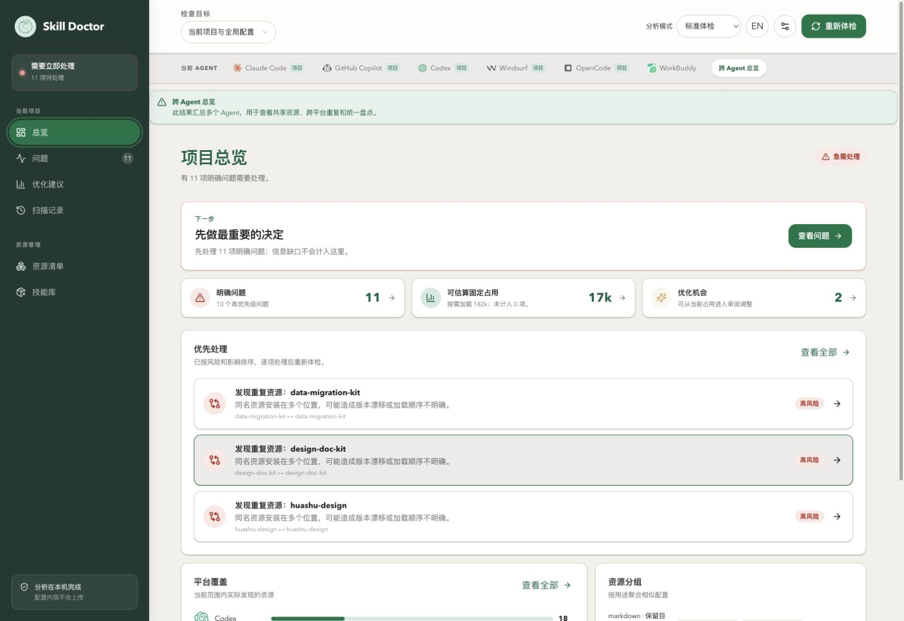

**What this confirms:** The results cover multiple agents, rather than Codex alone. This machine’s overview has **11 clear issues**, including same-name resources installed in different locations. These are leads for tracing their sources.

**Why it helps:** Set the scan boundary first so you can tell whether a missing resource is simply outside the selected scope. The cross-agent results here cannot be compared directly with the Codex-only results in the previous manual, and the combined cost is not one agent’s actual per-request input.

## 3. Open the inventory and establish a baseline

**Action:** Click “Resource management → Resource inventory” (资源管理 → 资源清单) in the left navigation. On first entry, keep all types, platforms, and scopes selected, along with “Active assets only (default)” (仅有效资产（默认）).

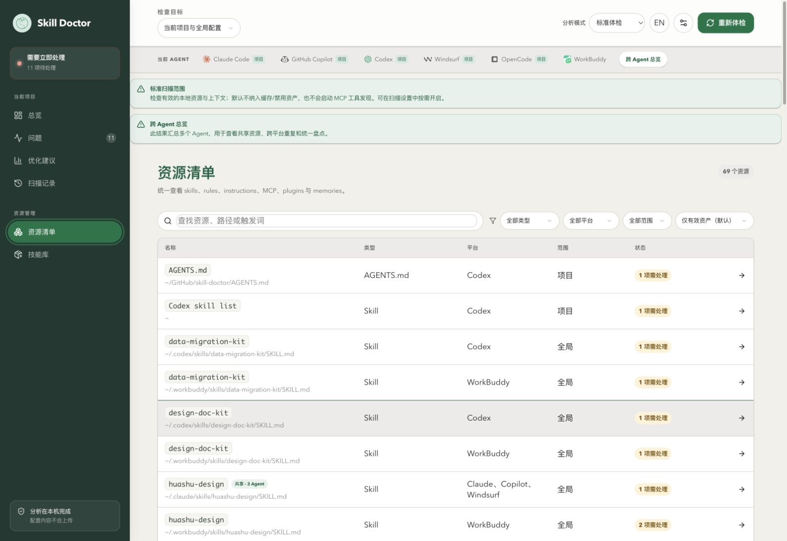

**What this example shows:** The upper-right corner reports **69 resources**. The list includes project <code>AGENTS.md</code> files and global Skills. Same-name <code>data-migration-kit</code> entries come from <code>.codex</code> and <code>.workbuddy</code>. Some entries carry a “Shared” (共享) badge.

**How to use this result:** Treat it as a baseline for later lookups and pre-change checks. It is not a list of 69 installed Skills, nor does it mean all 69 entries were injected into a particular conversation. The inventory contains different types, shared entries, and aggregate entries such as <code>Codex skill list</code>. To find a specific file, inspect its source instead of acting on its name alone.

“Active assets only” still shows resources with open issues; “active” does not mean “issue-free.” The **11 issues** in the sidebar also need not match the resource count: one issue can involve multiple resources.

## 4. Filter to resources used by one agent

**Use this when:** You work with Codex and want to find its configuration in the full inventory while keeping shared-use information visible.

**Action:** Select **codex** from the “Platform” (平台) dropdown to the right of the search box. Leave “Cross-agent overview” selected at the top.

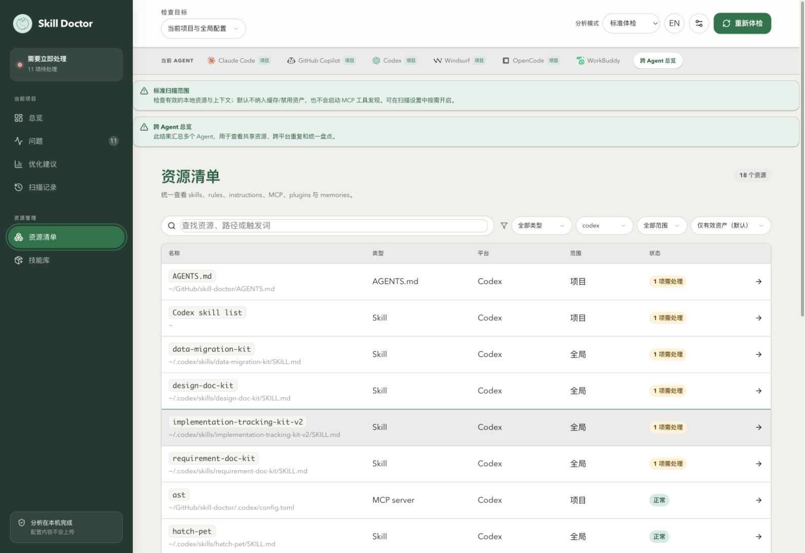

**What this example shows:** The list shrinks to **18 resources**. No new scan ran; this filter only selected entries whose users include Codex from the existing snapshot.

**Why it helps:** If you are responsible for one agent, this reduces unrelated entries. Shared resources still show their complete user list, so you can assess who else may be affected. If a result lists “Codex, OpenCode,” that does not mean filtering failed; both agents use that resource.

These two controls affect different stages:

| Control | What it changes | When to use it |
| --- | --- | --- |
| Top-level inspection scope and agent tabs | The input boundary when a scan runs | The current snapshot does not include the target project, platform, or global configuration |
| Inventory platform, scope, type, and status filters | Which entries from the current snapshot are shown | The scan already contains enough data and you only want to narrow the results |

Inventory filters cannot add resources that were not included in the scan.

## 5. Find a specific resource by type and keyword

**Use this when:** You know roughly what the resource is called and want to see whether the project already has that capability before installing another copy.

In the current inventory:

1. Set “Type” (类型) to **Skill**.
2. Search for **skill-doctor-context-optimizer**.
3. Keep “Scope” (范围) set to **All scopes** so project and global resources are both included.

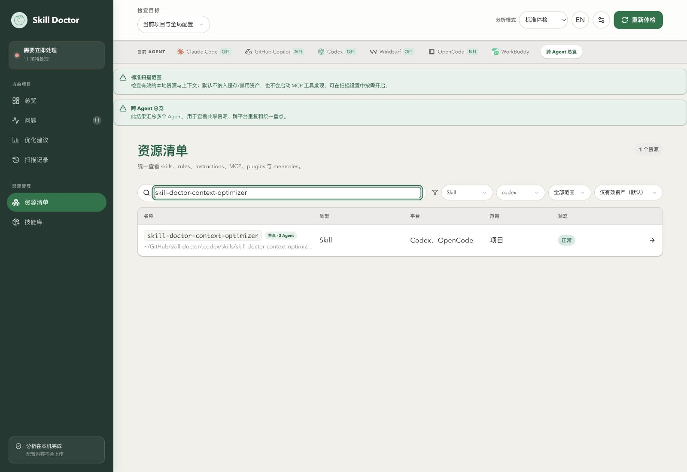

**What this example shows:** The result is **1 resource**. Its scope is “Project” (项目), its status is “Normal” (正常), its platform column lists “Codex, OpenCode,” and it has a “Shared · 2 agents” (共享 · 2 Agent) badge.

**What you can conclude:** The project already has a Skill with this name, and the scan recognized two users. Check its purpose and source next instead of installing another copy because two agents appear in the list.

The search box also matches paths, descriptions, configuration sources, and trigger information, not just names. For example, searching for this repository name, <code>skill-doctor</code>, may also find other project resources whose paths contain that string. Use a more specific name or path fragment to narrow the results. Search does not scan the complete file contents.

## 6. Open the details and decide whether it fits the task

**Action:** Click the resource you found. The detail panel opens on the right. First read the description and “Agents using this resource” (使用这个资源的 Agent).

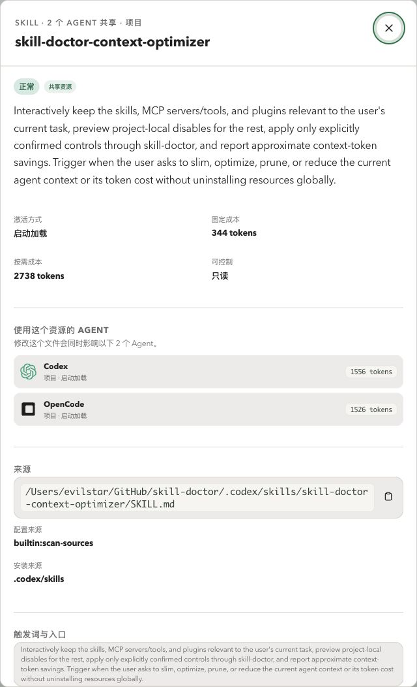

**What this example shows:**

- The description says it organizes Skills, MCPs, and Plugins for the current task, previews changes before control actions are explicitly confirmed, and reports estimated context savings.
- The listed users are **Codex** and **OpenCode**, both at project scope.
- The page marks it “Read-only” (只读) and shows fixed and on-demand costs, with estimates by agent.

**How to use this information:**

- If your goal is to reduce context for the current task, the description helps you decide whether you found the right capability. It only states the intended purpose; check the source and actual task as well.
- Before changing a shared resource, consider both users and verify behavior in each agent.
- “Read-only” means the product cannot directly control this resource. It does not say that the file is unwritable on disk or that you must uninstall it.
- The top-line **344 / 2,738 tokens** is the aggregate estimate for this shared entry. The breakdown lists **1,556** for Codex and **1,526** for OpenCode. Do not add these values together and treat them as Codex’s fixed per-request cost.

Activation method and cost depend on the scan’s estimation rules. Seeing a resource in the inventory does not mean its full contents were invoked or loaded in an actual session.

## 7. Trace the source and find the file to read

**Use this when:** You found the right resource but do not know which file to inspect or change, or you need to give a maintainer a precise report.

**Action:** Scroll down in the detail panel to “Source” (来源), “Configuration source” (配置来源), “Installation source” (安装来源), “Triggers and entry points” (触发词与入口), and “Related issues” (关联问题). To read the original file, use the copy icon next to its source path, then open that path in your editor.

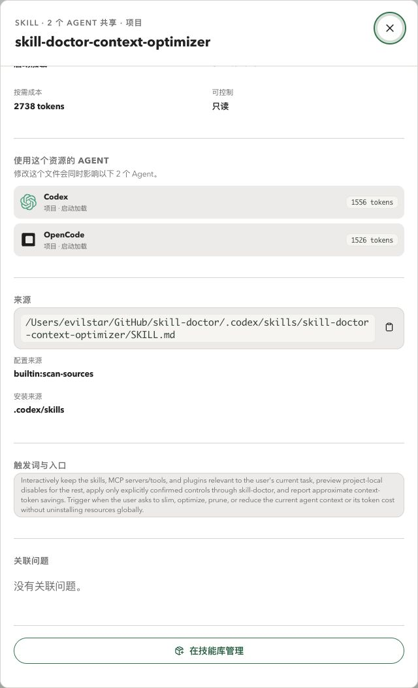

**Evidence from this example:**

```text
Source: /Users/evilstar/GitHub/skill-doctor/.codex/skills/skill-doctor-context-optimizer/SKILL.md
Configuration source: builtin:scan-sources
Installation source: .codex/skills
Related issues: No related issues.
```

On this machine, the entry resolves to [the Skill source in this repository](../../skills/skill-doctor-context-optimizer/SKILL.md). Compare the description with its full execution requirements there.

**How to use the evidence:**

| Information | What it helps confirm | What it does not establish |
| --- | --- | --- |
| Source path | Which local entry to open and inspect | Do not guess another file from a shortened path or name |
| <code>builtin:scan-sources</code> | This entry was discovered by the built-in scan-source rule | It does not mean the Skill is officially provided or security-certified |
| Installation source <code>.codex/skills</code> | Which configuration directory exposed the entry | It is not necessarily the upstream repository, author, or original publisher |
| Triggers and entry points | Intended uses and trigger clues stated in the description | Not a runtime log proving that the host triggered or ran it |
| No related issues | This scan found no issue associated with this entry | Not a guarantee of safety or effectiveness |

The detail panel does not show the complete file contents. To check constraints, steps, and permission boundaries, read the source file. If the path is a link, verify its actual target too. Copying the path does not edit the file.

You can now report the precise project, resource, entry point, and affected agents to a maintainer instead of providing only a potentially ambiguous Skill name. “Manage in skill library” is a further management entry point; tracing the source is enough to finish this lookup. You do not need to import or redeploy the resource just to view its details.

## 8. If a resource is missing, rule out filters first

**Use this when:** A resource you just saw disappears and you suspect it was uninstalled or the scan failed.

### 8.1 Reproduce the empty result

Close the details panel. Keep the current keyword, Skill type, and codex platform filter; set the inventory “Scope” (范围) to **Global**.

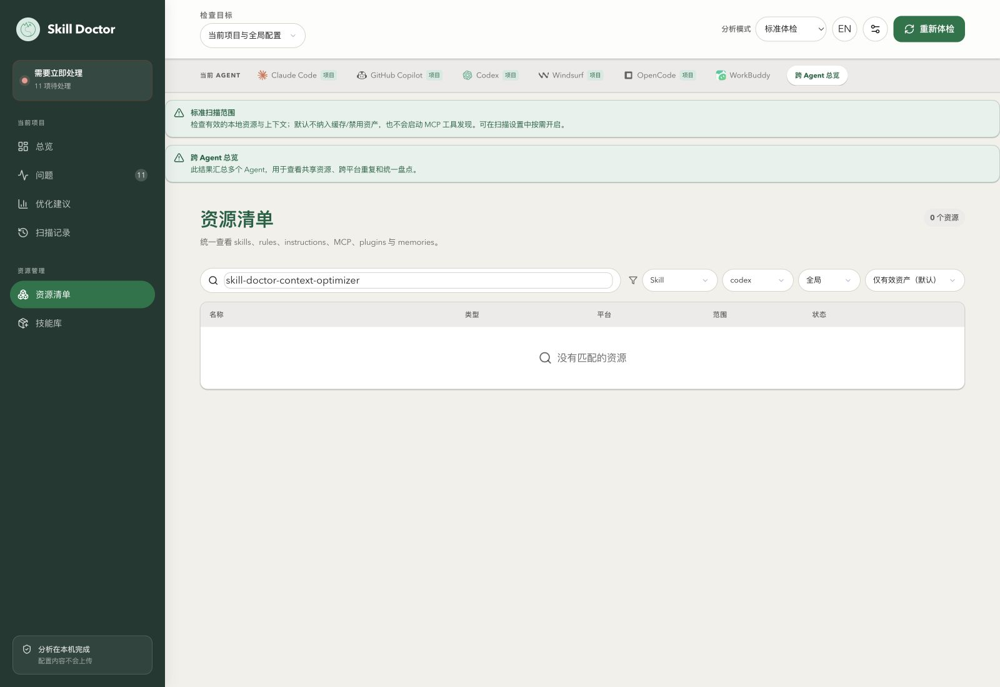

**Why the result is empty:** Figure 4 showed that the target entry is marked “Project.” It is excluded by the current global-only filter. Nothing was uninstalled, and no new scan ran.

### 8.2 Restore the matching scope

Change the same “Scope” dropdown to **Project**.

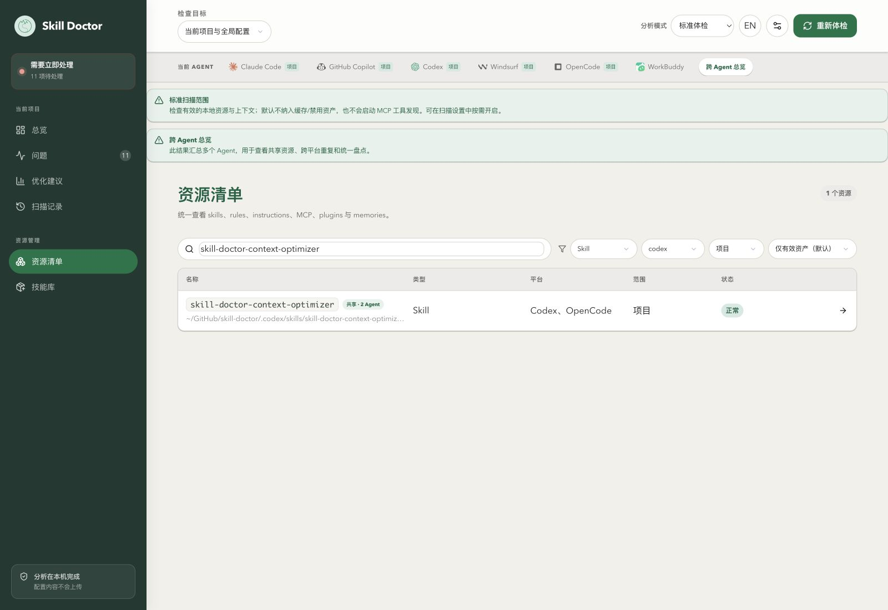

**Why it helps:** The result returns to **1 resource**, confirming that the filter caused the entry to disappear and avoiding an unnecessary reinstall.

When investigating a real missing entry, loosen the keyword, type, platform, scope, and status filters one by one. If it still does not appear, check the top-level scan boundary and “Scan settings → Scan sources and paths” (扫描设置 → 扫描来源与路径), then run a new scan. “All statuses” can only expand what the current snapshot displays; it cannot restore disabled or cached resources that were excluded when scanning.

## 9. Branch 1: Is a same-name resource shared, or are there multiple copies?

**Use this when:** Two agents behave differently with a same-name capability, or one copy was updated while another still uses older content.

Starting from the current inventory, change these filters:

1. Keep “Type” set to **Skill**.
2. Change “Platform” to **All platforms**.
3. Set “Scope” to **Global**.
4. Replace the keyword with **data-migration-kit**.

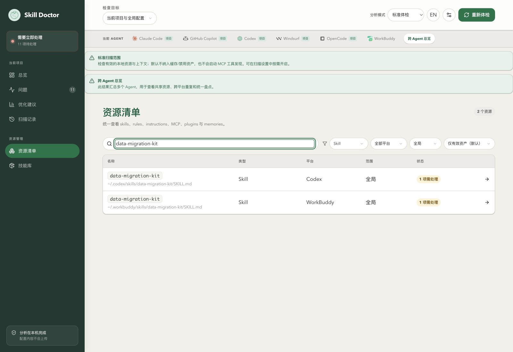

**What this example shows:** **2 rows** appear, with sources at:

```text
~/.codex/skills/data-migration-kit/SKILL.md
~/.workbuddy/skills/data-migration-kit/SKILL.md
```

This differs from Figure 4, which showed one resource, two users, and a shared badge. The inventory here recognizes two separate sources, each with **1 issue to review**.

**Why it helps:** You can compare the contents and versions at both locations instead of assuming same-name resources stay synchronized. A shared resource does not guarantee identical behavior across agents either; whether independent copies should be consolidated depends on whether each agent needs customizations.

## 10. Follow a related issue to verify the copy sources

### 10.1 Open the issue from the resource

Click the **Codex** row in Figure 9 and scroll down in its details to “Related issues” (关联问题).

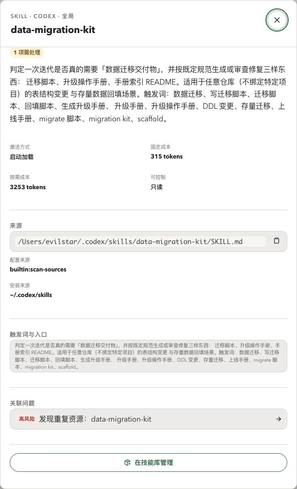

**What this example shows:** The source is a <code>SKILL.md</code> in the Codex user directory. Its description concerns data migration deliverables, and its related issue is **Duplicate resource found: data-migration-kit** (发现重复资源：data-migration-kit).

**Why this step helps:** Confirm which file you are viewing and what it is for before acting, so you do not change the other same-name resource by mistake. “1 issue to review” is the number of related issues, not evidence of a malicious instruction.

### 10.2 Check the issue evidence

Click the related issue to open the duplicate issue evidence.


**What this confirms:** Copy A points to <code>.codex/skills</code>; copy B points to <code>.workbuddy/skills</code>. These match the two sources in Figure 9. If you are investigating version drift, take both paths and compare the files rather than sharing only a screenshot that says “duplicate.”

**How to decide what to do next:** Compare the contents, maintenance sources, and purpose for each agent before deciding to keep both, manage them centrally, or clean one up. This walkthrough closes the panel after checking the evidence; it does not enter a deletion confirmation or delete anything. The UI’s “keep one copy” suggestion cannot replace this review. For later comparison, see [<code>diff</code> and <code>conflicts</code> in the CLI reference](../README.md).

## 11. Branch 2: Does an MCP server come from project or global configuration?

**Use this when:** An MCP server appears for a project and you need to find the configuration entry, or it looks normal in the UI but its tools are unavailable.

### 11.1 Find project MCP configuration

Close the details panel, clear the search box, set “Type” to **MCP**, “Platform” to **codex**, and “Scope” to **Project**. This walkthrough still uses the cross-agent scan snapshot.

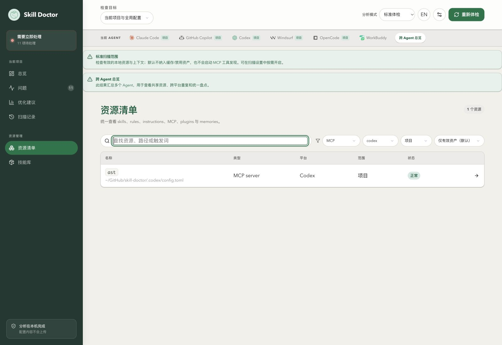

**What this example shows:** The list contains only **ast**, with the shortened source path <code>.codex/config.toml</code> in the current project and a “Normal” status.

**Why it helps:** Start by checking the project configuration entry rather than searching through every global MCP configuration. To find a global server, widen the inventory scope and confirm that the top-level scan included global configuration.

### 11.2 Inspect the source and evidence limits

Click **ast** to open its details.

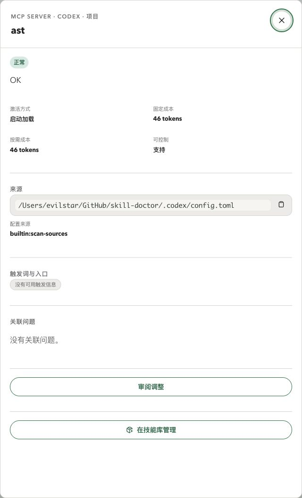

**What this confirms:** The configuration entry is <code>/Users/evilstar/GitHub/skill-doctor/.codex/config.toml</code>. The page shows “Normal” and “No related issues,” but this standard check did not perform MCP tool discovery.

**What this does not confirm:** The server can start, authentication succeeds, its tool list can be retrieved, or an agent has actually called it. Values such as <code>46 tokens</code> are not evidence that the complete live tool schema was obtained.

When troubleshooting unavailable tools, use the source path to check the configuration, then inspect the service or run tool discovery as needed. Do not stop investigating because the inventory status is normal. Before opening the source file, confirm that you are reviewing configuration; “Control supported” does not mean you should disable the server. This walkthrough did not click “Review changes” (审阅调整).

## 12. Turn the lookup into actionable information

At the end of the main workflow, this example has a summary that can be handed to a maintainer:

| Question | Finding from this machine | How it helps next |
| --- | --- | --- |
| What was found? | <code>skill-doctor-context-optimizer</code>, a project Skill | Avoid installing a second copy based on an ambiguous name |
| What is it for? | It says it reduces context for a task, previewing changes before confirmation | Decide whether it fits the current need |
| Who is affected? | The scan recognized Codex and OpenCode as users | Consider both users before changing it |
| Which file should be read? | The full source in Figure 6 and its actual link target | Avoid editing another same-name file |
| Are there issues? | No issue is associated with the target Skill; a separate same-name example has a duplicate issue | Distinguish continued use from further review and maintenance |

Possible next steps depend on what you found:

- **Purpose and source are correct:** Keep it as is and read the complete Skill instructions when needed.
- **You plan to change a shared resource:** Confirm its users and link target, then test the affected agents.
- **Same-name resources have different sources:** Compare their contents and purposes before deciding whether to manage them together.
- **The list is empty:** Rule out filters and scan scope before assuming the installation is missing.
- **MCP configuration exists but its tools are unavailable:** Check the service and runtime evidence instead of relying on the inventory status alone.

The inventory provides traceable evidence for decisions. It does not replace actual invocation records, a complete security assessment, or runtime cost measurements.

## 13. Information in these screenshots to review before sharing

The screenshots show the actual local environment and have not been additionally redacted. The environment owner may want to review these details before sharing them publicly:

| Image | Location and information |
| --- | --- |
| Figures 1–3 and 9 | Overview issue cards and inventory names or paths, including local Skill names, install directories, and agent distribution |
| Figures 4, 7, 8, and 12 | Shortened real project paths and the Skill or MCP names in that project |
| Figures 5 and 6 | <code>/Users/evilstar/</code> user directory and full project path in the source section, along with shared users |
| Figure 10 | Chinese purpose description and trigger notes for the local <code>data-migration-kit</code>, user directory, and installation source |
| Figure 11 | Full user-directory paths for copies A and B and the target path in the deletion panel; the confirmation button is disabled and no confirmation value was entered |
| Figure 13 | MCP project configuration path and server name |

These screenshots do not show API keys, MCP environment variable values, or local service session credentials.

Further reading: [Project health check](health-check.md) · [CLI and comparison reference](../README.md) · [Skill library management](skill-library.md).

Next: [Duplicate and conflict diagnosis](conflicts.md), which checks copy contents and sources, reviews trigger overlap, and verifies results under the same scan conditions.
