# Security Audit Manual

[Manual index](README.md) · [English project README](../../README.md#documentation) · [中文](security-audit.zh-CN.md) · [Previous: Context cost and budget](context-budget.md) · [CLI reference](../README.md)

Use this manual before installing an unfamiliar Skill, after updating a resource, or when you notice automatic execution or network activity. The goal is to understand what the system detected, locate the original instructions, check behavior and authorization boundaries, and decide whether to keep it, add constraints, pause its use, or investigate further.

This walkthrough uses the actual local environment without adding any risky resources. Standard check reported **0 security issues**. We then use the existing local resource <code>baoyu-danger-gemini-web</code> to demonstrate a manual review. The UI shows it as “Normal,” but its instructions still discuss file input, browser authentication, and Cookie caching. This illustrates the difference between “no current alert” and “a security review has been completed.”

## 1. Define the boundary of this review

- Date: **2026-10-19**; macOS; Skill Doctor repository version **0.7.1**.
- Project: <code>/Users/evilstar/GitHub/skill-doctor</code>.
- Scope: **Current project and global configuration**, **Cross-agent overview**, **Standard check**.
- AI security audit, AI conflict analysis, and MCP tool discovery were all off. Disabled resources and plugin cache were not included.
- This walkthrough only scanned, checked sources, and reviewed parts of the original instructions and scripts read-only. It did not run the Skill, install dependencies, log in, read authentication data, submit input, or change resources.

In the current version, **standard security rules check names, descriptions, and trigger information**. They do not inspect the full contents line by line or execute attached scripts. AI audit is a separate optional entry point; it attempts to read the contents and send them, along with the name, platform, scope, and source, to the configured analysis service. Do not describe standard mode as a complete audit of the full contents.

Figures 1–5 and 9–11 are screenshots of the product UI. Figures 6–8 are an attached **read-only review record of original local files**, with real line numbers and clear labels that they are not product pages or automated findings. The attached record is not a new Skill Doctor feature.

## 2. Choose the scope and confirm the audit mode

Start the local UI:

```bash
npx @evilstar2025/skill-doctor ui /path/to/your-project
```

Replace the path with your actual project directory. For source setup, see [Starting the local UI](health-check.md#2-start-the-local-ui). This walkthrough ran <code>npm run dev -- ui . --port 4173 --no-open</code> and opened the full local URL printed by the terminal.

1. Set the top-level “Inspection scope” (检查范围) to **Current project and global configuration** (当前项目与全局配置), and the analysis mode to **Standard check** (标准体检).
2. Click **Cross-agent overview** (跨 Agent 总览) and wait for the check to finish. If you only changed the scope, click “Rescan” (重新体检).

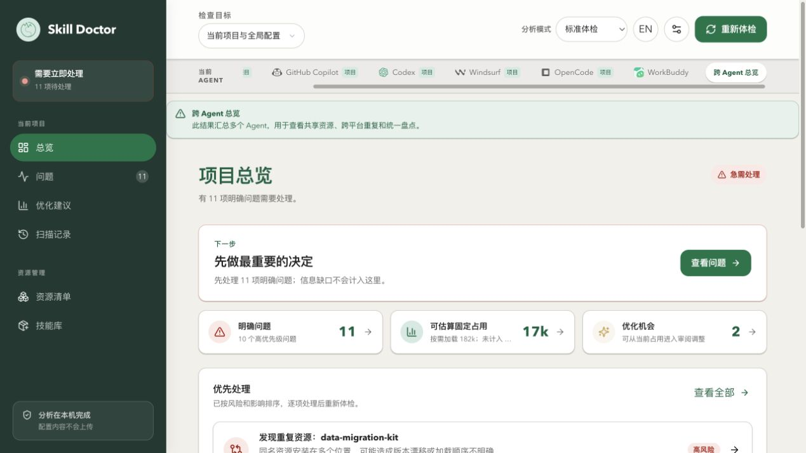

**What this example shows:** The overview has **11 issues to review**, including **10 high-priority issues**. You cannot call these 10 security risks; the overview combines different issue types.

Click **Scan settings** (扫描设置) at the top, scroll to “Deep analysis” (深度分析), and check the status of AI security audit and MCP tool discovery. This walkthrough only checks the settings and then closes them.

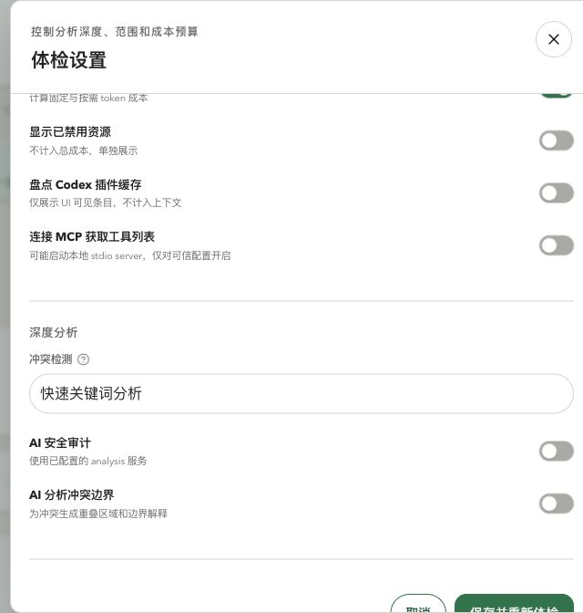

**Why it helps:** Record which capabilities produced the result. A configured model service does not mean an AI audit ran. If a resource’s source is unclear, start with static inspection. Turning on MCP tool discovery may run a local command specified in the configuration, so inspect that configuration before deciding.

If an analysis service is configured, the resource detail’s explanation feature may still use it. That is separate from the AI security audit switch used during a scan.

## 3. Filter security issues and rule out hidden results

**Action:** Open “Issues” (问题) in the left navigation, clear the search, set “Type” to **Security** (安全), and “Severity” to **All levels** (全部等级).

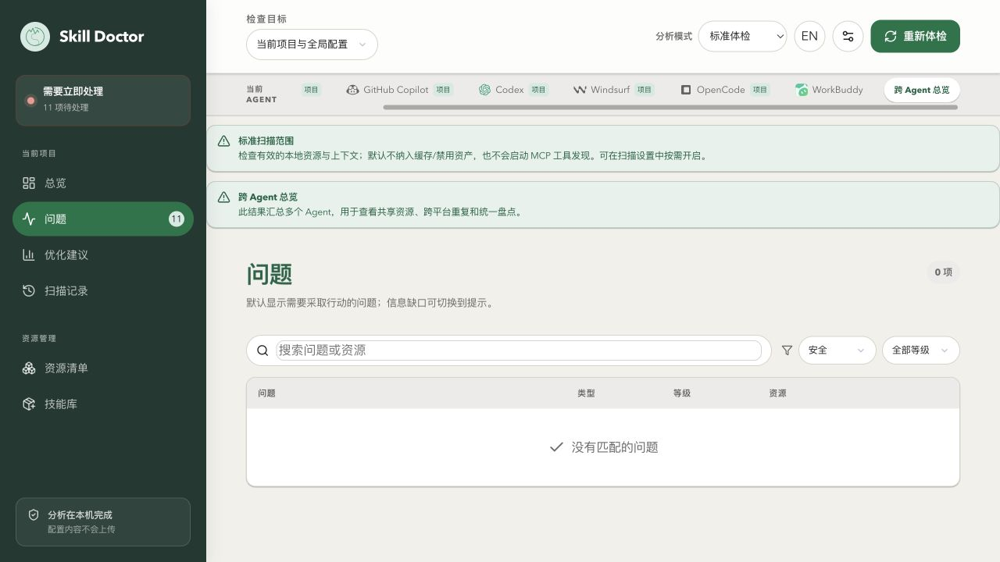

**Finding from this example:** Under this scope, the standard rules, and the current configuration filters, the security category shows no issues. There are still 11 issues overall: 10 duplicates and 1 context-budget issue.

**How to use a zero result:** Record it as the result of this standard check, then choose resources for manual review based on their sources and capabilities. It does not prove that all contents, attached scripts, dependencies, or runtime behavior are safe.

If a result seems unexpected, check the project/global scope, agent, search term, severity, disabled state, and existing ignore configuration. Then check whether the detection rules cover the behavior in question. Seeing no result after selecting “High risk” because lower-severity items are hidden, or hiding an alert with an ignore rule, is not evidence that a risk was fixed.

## 4. What risk levels and detection categories mean

Severity helps prioritize review; it is not the probability of malicious behavior or the number of times it occurred. The default mappings in the standard rules are shown below. AI results may assign different levels based on context.

| Level | Typical signal in standard rules | What to review manually |
| --- | --- | --- |
| High risk | Shell execution instruction (<code>shell-exec</code>); destructive actions such as deleting or clearing data (<code>destructive</code>) | What runs, what it affects, whether there is a preview or backup, and who explicitly authorizes it; review high-impact behavior before use |
| Medium risk | Descriptions about outputting, sending, or exposing credentials (<code>secret-leak</code>) | Whether real secrets are involved, the recipient and logs, and whether redacted values are used; actual leakage can be more serious than the default rule level |
| Low risk | Descriptions of external requests, uploads, or API calls (<code>network-call</code>) | Destination, fields sent, necessity, and authorization; low risk does not mean any data can be uploaded |
| Notice | Page information such as evidence gaps that are not actionable issues | Read the reason and collect evidence; do not treat it as a completed security review |

Static mode matches word forms. It may match a tutorial example, a prohibition, or a legitimate operation; it may also miss behavior in the full contents. Shell, network, and authentication capabilities all need context.

### If your environment has a security alert, how do you locate it?

This machine has no non-empty security rows, so this manual does not invent an alert. For an actual result:

1. Click the security issue and record its title, severity, affected resources, evidence snippet, and suggestion.
2. Use **Copy path** (复制路径) in the evidence section. Open the full path; distinguish same-name resources by platform and path.
3. Search for the original matched text in an editor and read the surrounding paragraphs and referenced scripts. A snippet may be only a small match, and the current details do not provide a reliable source line number. Do not treat the snippet as the complete instruction.
4. Determine whether the text asks to do something, prohibits it, gives an example, or quotes another source. Then check the target files, data recipients, confirmation conditions, and recovery method.

Both standard and AI evidence should be checked against the original content. The next sections demonstrate how to do the same manual review proactively from the resource inventory, even when there is no alert.

## 5. Choose a resource by purpose and trace it to a local file

### 5.1 Find the resource to review

**Action:** Open “Resource inventory” (资源清单). Keep all types, platforms, scopes, and the default active-resource status. Search for **baoyu-danger-gemini-web**.

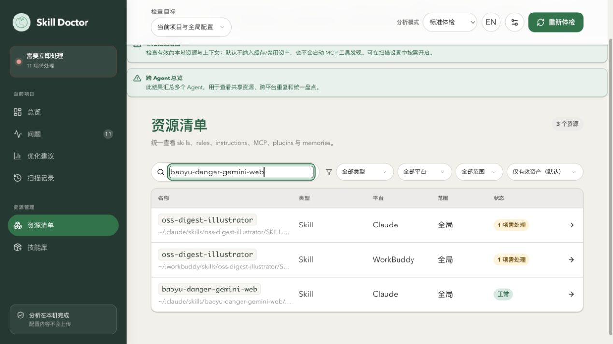

**What this example shows:** The search returns **3 resources**, including two <code>oss-digest-illustrator</code> entries whose descriptions refer to it. This does not mean there are three copies with the same name. Click the entry named exactly <code>baoyu-danger-gemini-web</code>.

**Why this resource was selected:** Its stated purpose involves generating content through the Gemini Web API, so a manual review should look at file/image input, authentication state, and external requests. The word “danger” in the name is not grounds for an automatic verdict.

### 5.2 Record the platform, source, and purpose

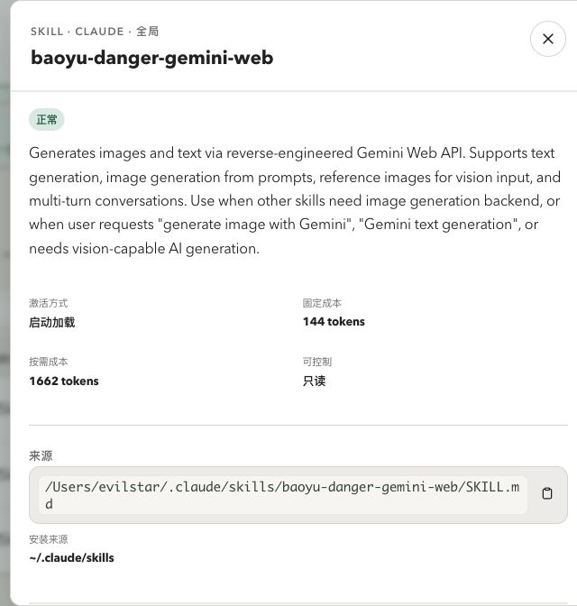

**What this example confirms:** Platform is **Claude**, scope is **Global**, and the entry point is:

```text
/Users/evilstar/.claude/skills/baoyu-danger-gemini-web/SKILL.md
```

“Normal” only means that no issue needing attention is currently associated with this resource; it is not a security certification. “Installation source” is the directory where scanning discovered it, not proof of repository identity, version, or content integrity.

Open the original in a local editor using this full path, in read-only mode. If the entry is a link, check its actual target first. Here it resolves to <code>/Users/evilstar/GitHub/baoyu-skills/skills/baoyu-danger-gemini-web/SKILL.md</code>, whose file version is marked **1.56.2**. Editing it directly would affect that skill repository, so confirm the maintenance relationship first.

The attached [read-only review record of the original files (HTML; download and open locally)](../../assets/manual/security/source-review.html) documents the entry point, actual path, SHA-256, selected line numbers, and manual findings. The screenshots are not a demo of an editor feature. For your own review, open the actual file and its full context; line numbers may change in later versions.

## 6. Locate suspicious instructions and check constraints and authorization

### 6.1 Search for execution entry points and user consent

**Action:** Search the original for terms such as <code>scripts/</code>, <code>npx</code>, and <code>Consent</code>. Identify the execution entry point, then read the consent conditions and rejection branch.

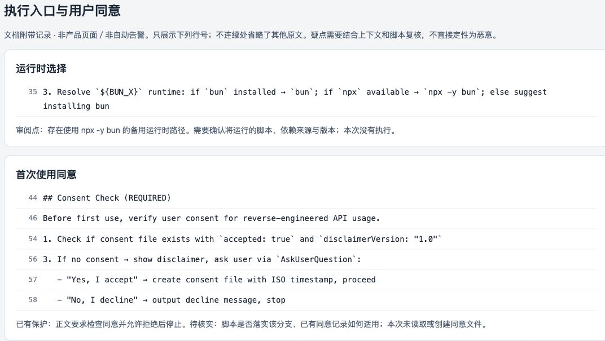

**Evidence found:** Line **35** has a fallback runtime selection using <code>npx -y bun</code>. The related entries in lines **44–58** require checking consent before first use and stop if consent is declined.

**How to interpret it:** There is an execution capability that needs review, along with stated safeguards. Continue by checking the dependency’s source and version, which script will run, the scope of consent, and how the host or script enforces the rejection branch. A written confirmation requirement does not prove that it is enforced.

This walkthrough did not run the excerpted command or read or create a consent record. Do not record that “user consent was obtained” or “the protection logic passed testing.”

### 6.2 Trace input and credential-related terms to understand data boundaries

**Action:** Search for <code>promptfiles</code>, <code>reference</code>, <code>cookie</code>, and <code>profile</code>. Check which local content may be used as input and which browser state may be involved.

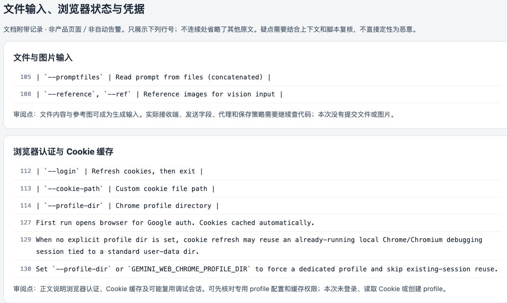

**What this example shows:**

- Lines **105 and 108** describe prompt-file and reference-image input.
- Lines **112–114** list login, Cookie paths, and browser profile arguments.
- Lines **127 and 129–130** describe first-time browser authentication, Cookie caching, possible reuse of an existing debug session, and an option to specify a dedicated profile.

**Why it helps:** Manual review can now ask concrete questions: Which files and images are allowed as input? Who receives the content? Is a dedicated browser environment used? Where is the cache stored, and who can read it? Could authentication values be written to logs? These questions help decide what to do more than a vague judgment that “it uses the network, so it is dangerous.”

This walkthrough only read these instructions; it did not access browser authentication data or the cache. A dedicated profile is an isolation approach described in the file. Check its implementation and actual configuration before concluding that credential risks are ruled out.

### 6.3 Follow referenced scripts to inspect actual reads, writes, and requests

**Action:** Follow the reference to <code>scripts/main.ts</code> and check file reads and generation calls, then inspect the upload implementation and destination constants under <code>scripts/gemini-webapi/</code>. An editor search is enough; you do not need to run the generation command during review.

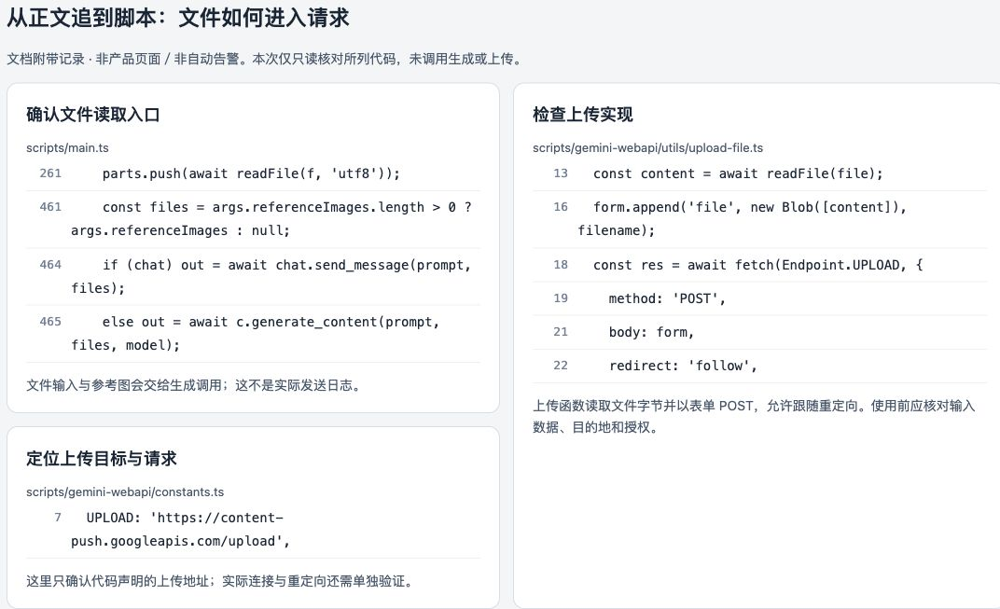

**Read-only findings in this walkthrough:** Line **261** of <code>main.ts</code> reads file contents; lines **461 and 464–465** pass reference-image arguments to a generation call. Line **7** of <code>constants.ts</code> declares an upload URL. The relevant entries at lines **13, 16, and 18–22** of <code>utils/upload-file.ts</code> read file bytes, construct a form, issue a POST, and allow redirects to be followed.

**What this means:** Some of the evidence chain from the instructions to the implementation is visible, so inputs, destinations, and authorization should be clear before use. The URL in code is a declared value, not a record of network traffic in this walkthrough. The presence of read or upload code alone does not prove data was stolen.

This was not a full audit of dependencies, network branches, redirects, recipient handling, cache permissions, or runtime behavior. Keep those gaps in the review record; do not declare the entire Skill “safe” or “malicious.”

## 7. Turn review findings into a decision

For each finding, record the **resource and full path, version or file identifier, original excerpt and location, behavior and impact, existing safeguards, unresolved questions, decision, and verification method**.

This example can be recorded without changing the resource:

| Evidence and current state | Current assessment | Possible next step |
| --- | --- | --- |
| Instructions require consent before first use and say to stop if declined | A safeguard is specified; enforcement has not been verified | Check host execution and script branches; do not reuse historical consent for arbitrary new input |
| File/image input is supported and some scripts implement uploads | Data boundaries need to be clear; this walkthrough has no evidence of an actual send | Before use, confirm input types, destination, necessity, and authorization; pause that use if external transfer is unacceptable |
| Instructions mention Cookie caching and reuse of a debug session | Authentication isolation and cache permissions need further review | Consider a dedicated profile, least privilege, and credential handling; do not copy credential values into review notes |
| Standard security category currently has 0 issues | This is the standard detection result and does not cover all the behavior above | Keep manual follow-ups; do not skip review because there is no alert |

For other real alerts, choose an approach based on the evidence:

| Review finding | Possible approach | What to verify |
| --- | --- | --- |
| Command or network behavior is reasonable and necessary | Document the execution scope, data, and destination; add suitable confirmation requirements | Real tasks stay within the authorized scope, and the operation can stop when declined |
| An example or prohibition was falsely flagged | Keep the surrounding context and record why it is a false positive; consider clarifying the wording | Required constraints remain, rather than removing protective language to eliminate a keyword |
| A destructive step lacks safeguards | Pause that step and add preview, backup, a clear target, and explicit confirmation | Verify safeguards and recovery with isolated test data |
| Credential output or unauthorized transfer is confirmed | Pause the behavior and revise data handling; if a leak occurred, arrange credential response | Original credentials no longer appear in output, logs, or requests, and the impact scope is checked |
| Source or implementation cannot be confirmed | Pause the relevant capability and investigate the maintenance source and dependencies | Decide whether to enable it after collecting the key evidence |

Before editing, check shared users and actual link targets. Suggestions in issue details are a starting point for review. Security issues do not have a general one-click fix, and duplicate cleanup is not a substitute for security remediation.

## 8. Rescan and distinguish diagnosis from remediation

### 8.1 Rescan with the original scope

Close the resource details and return to “Issues.” Click “Rescan” and wait for it to finish. Reconfirm that search is empty, “Type” is **Security**, and “Severity” is **All levels**. Do not assume old filters remain when returning from another page.

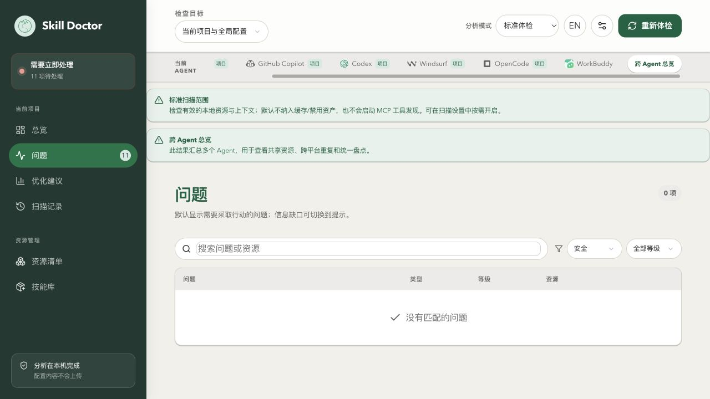

**Why nothing changed in this example:** The walkthrough only viewed and checked resources; it did not edit contents or scripts, change resource state, or change scan policy. Adding manual follow-ups does not automatically create a security alert or mark anything as fixed.

Restore “Type” to **All types** and “Severity” to **Needs attention**:

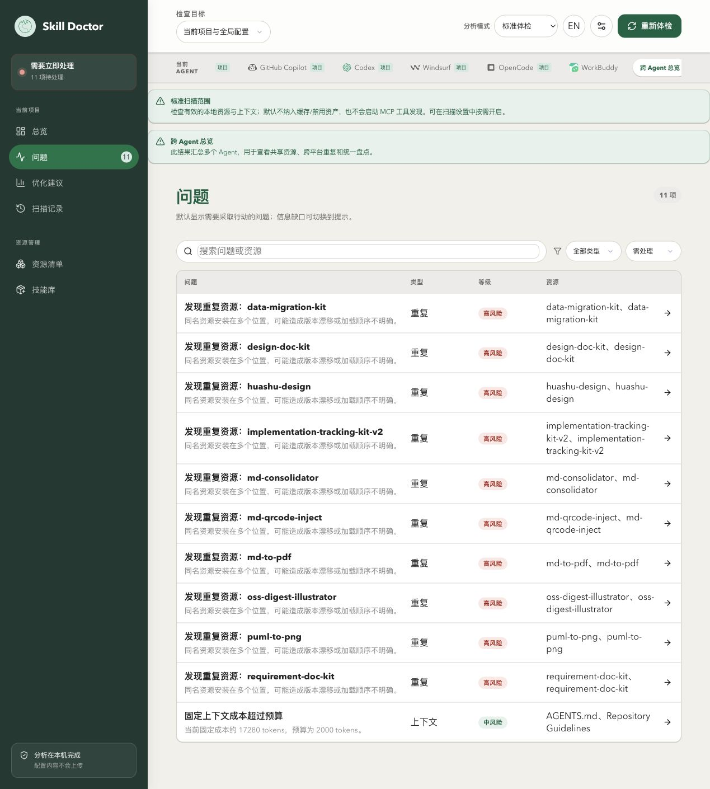

**Why it helps:** The empty security category did not resolve other issues. The project still has 11 items to review.

### 8.2 Compare against a compatible baseline

Open “Scan history,” select a baseline with the same project, agent, scope, and compatible estimation method, then click **Compare changes** (比较差异).

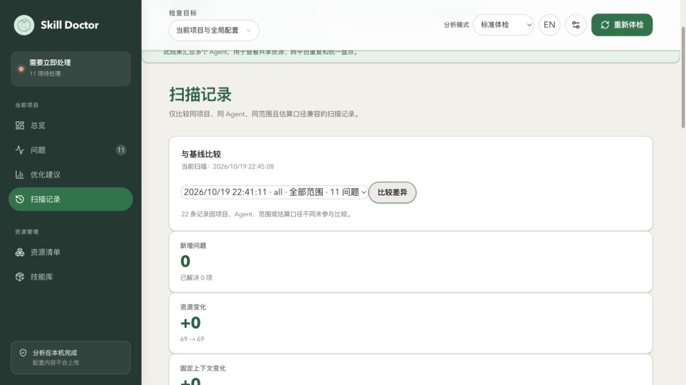

**Result from this example:** Comparing cross-agent, all-scope scans at **22:41:11** and **22:45:08** shows **0 new issues**, **0 resolved issues**, and **69 → 69 resources**, as expected after read-only checks.

After making an actual change, verify both the original behavior and the detection result. A content edit outside standard-rule coverage may not change the issue count. Conversely, changing the scan scope, hiding a resource, or ignoring an alert can lower the count without proving the risk is gone. For runtime behavior, use controlled input in a new task and record what remains untested.

## 9. How to arrange an AI audit of full contents

Figure 2 shows that AI security audit was off for this walkthrough. This manual did not run an AI audit and does not include a screenshot of its results.

If you plan to use it, first confirm the recipient, access controls, and data policy for the analysis service, and identify which files will be audited. AI audit attempts to send the complete contents. Judge local, on-premises, and cloud services by their actual destinations; do not rely only on a page label such as “local analysis.”

After confirming that the data may be sent to that service, turn on “AI security audit” (AI 安全审计) in “Scan settings,” save, and rescan. Review any new security evidence afterward. A saved model configuration does not prove that the service works. If a call or parse fails, coverage is incomplete, or cached results are used, an empty result does not prove that all contents were audited. Check AI suggestions against the original files and real usage; do not automatically run commands or fixes suggested by a model.

## 10. Information in the screenshots and attached record to review before sharing

These images show the actual local environment without additional redaction:

| Image or record | Location and information |
| --- | --- |
| Figures 1, 3, 4, 9, and 10 | Detected agents, resource names, issue distribution, current scan scope, and search term |
| Figure 2 | Settings for AI analysis, MCP tool discovery, disabled resources, and cache scanning |
| Figure 5 | Full user-directory path, Skill purpose, platform and scope, and cost estimates |
| Figures 6 and 7 | Original Skill excerpts and line numbers, consent flow, authentication method, and browser-state handling |
| Figure 8 | Parts of local script contents, line numbers, upload domain, and file-handling implementation |
| Figure 11 | Actual scan and baseline times, issue and resource counts; the context comparison area is visible below |
| Attached HTML | Username, installation entry point, resolved path in another repository, Skill version and SHA-256, and the excerpts and manual findings above |

The screenshots and record do not contain API keys, actual Cookie values, login credentials, the value of any consent record, real session contents, or local-service session credentials. The excerpts support review; they are not a security endorsement of this resource.

Further reading: [Resource inventory and source tracing](resources.md) · [Duplicate and conflict diagnosis](conflicts.md) · [Context cost and budget](context-budget.md).
